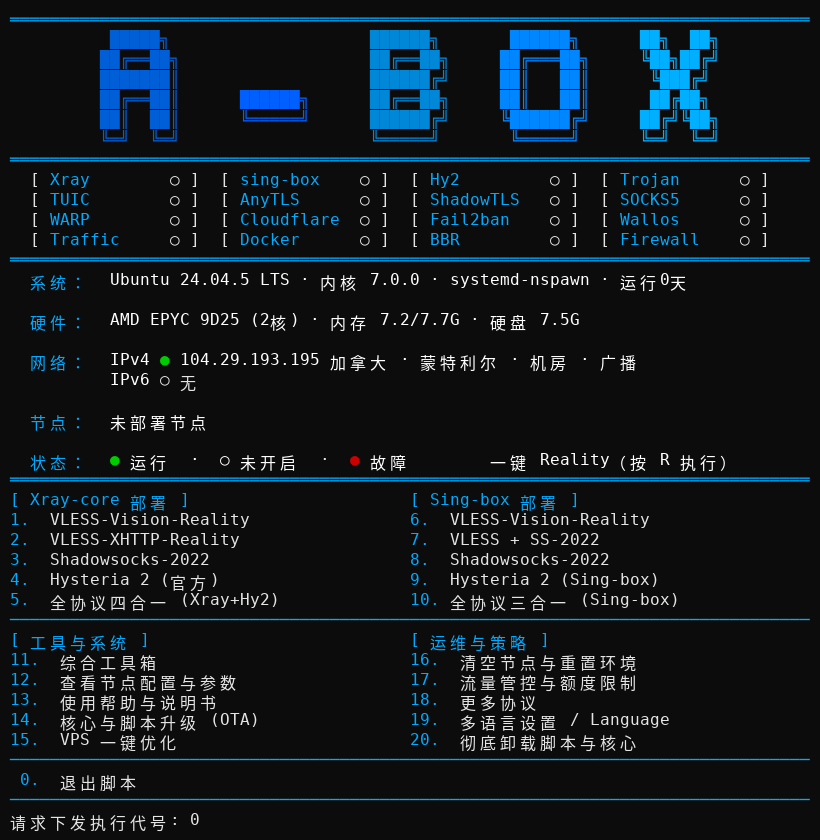

<div align="center">
  
  <h1>A-Box</h1>
  <p><b>جعبه‌ابزار استقرار و مدیریت یک‌جای سرویس‌های شبکه لینوکس</b> — اسکریپت Bash تک‌فایل · Xray / sing-box / Hysteria 2 · منوی شش‌زبانه</p>
  <p>
    
    
    
  </p>
  <p>
    <a href="README.md">English</a> ·
    <a href="README-zh.md">简体中文</a> ·
    <a href="README-zh-tw.md">繁體中文</a> ·
    <a href="README-ja.md">日本語</a> ·
    <a href="README-ru.md">Русский</a> ·
    <a href="README-fa.md">فارسی</a>
  </p>
</div>

---

## تصویر صفحه

منوی اصلی (ماتریس وضعیت، اطلاعات سیستم و شبکه و منوی استقرار):



## این چیست

A-Box یک اسکریپت Bash تک‌فایل است (`install.sh`، حدود ۲۶٬۰۰۰ خط) که سرویس‌های پروکسی و شبکه را روی یک VPS لینوکسی مستقر و نگهداری می‌کند. Xray و sing-box و سرور رسمی Hysteria 2 را نصب و پیکربندی می‌کند، پیکربندی کلاینت تولید می‌کند و کارهای روزمره — قوانین فایروال، محافظت Fail2Ban، تنظیمات DNS، پشتیبان‌گیری، به‌روزرسانی و عیب‌یابی — را در یک منوی تعاملی شش‌زبانه گرد هم می‌آورد. تا وقتی در منو انتخاب نکنید چیزی مستقر نمی‌شود و عملیات مخرب همیشه تأیید می‌خواهند.

## شروع سریع

منبع رسمی، با دستور قفل‌شده روی یک کامیت تغییرناپذیر:

```bash
curl -fsSL https://raw.githubusercontent.com/alariclin/A-Box/d63434e3b98d666896e37787b050e6f4e8737601/install.sh -o A-Box.sh && sudo bash A-Box.sh
```

آینه شخص ثالث همان فایل قفل‌شده (فقط مسیر انتقال است، نه یک درگاه رسمی):

```bash
curl -fsSL https://mirror.ghproxy.com/https://raw.githubusercontent.com/alariclin/A-Box/d63434e3b98d666896e37787b050e6f4e8737601/install.sh -o A-Box.sh && sudo bash A-Box.sh
```

- در سیستم Alpine تازه، ابتدا `apk add --no-cache bash curl` را اجرا کنید.
- پس از اولین اجرا، با وارد کردن `sb` منو دوباره باز می‌شود.
- پیش از استفاده در محیط واقعی، فایل دانلودشده را از یک کانال مستقل و قابل اعتماد بررسی کنید.

## منوی اصلی

| شماره | هسته Xray | شماره | sing-box |
|---:|---|---:|---|
| 1 | VLESS-Vision-Reality | 6 | VLESS-Vision-Reality |
| 2 | VLESS-XHTTP-Reality | 7 | VLESS + SS-2022 |
| 3 | Shadowsocks-2022 | 8 | Shadowsocks-2022 |
| 4 | Hysteria 2 (سرور رسمی) | 9 | Hysteria 2 (Sing-box) |
| 5 | همه‌کاره (Xray + Hy2) | 10 | همه‌کاره (Sing-box) |

بسته همه‌کاره Xray شامل Vision ‏(TCP 443)، ‏XHTTP ‏(TCP 8443)، ‏Shadowsocks-2022 ‏(TCP/UDP 2053) و Hysteria 2 ‏(UDP 443) است. بسته همه‌کاره sing-box شامل Vision و Shadowsocks-2022 و Hysteria 2 است و XHTTP ندارد.

| شماره | ابزارها و سیستم | شماره | عملیات |
|---:|---|---:|---|
| 11 | جعبه‌ابزار | 16 | پاک‌کردن نودها و بازنشانی محیط |
| 12 | مشاهده پیکربندی و لینک نودها | 17 | سهمیه ترافیک ماهانه |
| 13 | راهنما و دفترچه کاربر | 18 | پروتکل‌های بیشتر (زیرمنو در ادامه) |
| 14 | به‌روزرسانی هسته و اسکریپت (OTA) | 19 | تنظیمات زبان |
| 15 | بهینه‌سازی VPS | 20 | حذف اسکریپت و هسته‌ها |
| 0 | خروج | R | Reality با یک کلید (کلید میانبر) |

### پروتکل‌های بیشتر (منوی 18)

استقرارهای مستقل، جدا از بسته‌های ترکیبی بالا. هر پروتکل یک پورت می‌پرسد، پسورد تولید می‌کند یا می‌پذیرد، پیش از نوشتن، پیکربندی را با هسته بررسی می‌کند، لینک اشتراکش را در منوی 12 ثبت می‌کند و در پایان قوانین Fail2Ban را تازه می‌کند.

| شماره | پروتکل | توضیح |
|---:|---|---|
| 1 | Trojan-Reality | تروجان مستقل با REALITY؛ هسته Xray یا sing-box به انتخاب شما |
| 2 | TUIC | ‏TUIC v5 روی sing-box، ‏UDP، گواهی خودامضا |
| 3 | AnyTLS | ‏AnyTLS روی sing-box، با REALITY |
| 4 | SOCKS5 / Mixed | ‏SOCKS5 مستقل با احراز هویت؛ هسته به انتخاب شما |
| 5 | ShadowTLS | ‏ShadowTLS v3 روی sing-box، با عبور به یک ورودی داخلی Shadowsocks-2022 |
| 6 | Argo (CDN) | ‏VMess / VLESS روی WebSocket از راه تونل Cloudflare — هیچ پورت ورودی روی سرور باز نمی‌شود. تونل‌های موقت یک نشانی تصادفی `*.trycloudflare.com` می‌گیرند که با هر راه‌اندازی مجدد عوض می‌شود؛ تونل‌های ثابت از دامنه و توکن تونل خودتان استفاده می‌کنند |

## پنل وضعیت

بالای منو یک ماتریس وضعیت ۱۶ خانه‌ای (در حال اجرا / شروع‌نشده / خراب) دیده می‌شود: Xray، ‏sing-box، ‏Hy2، ‏Trojan، ‏TUIC، ‏AnyTLS، ‏ShadowTLS، ‏SOCKS5، ‏WARP، ‏Cloudflare، ‏Fail2ban، ‏Wallos، ‏Traffic، ‏Docker، ‏BBR و Firewall. پس از آن خطوط اطلاعات سیستم، سخت‌افزار و شبکه می‌آید. خط شبکه مکان و نوع IP خروجی را نشان می‌دهد (دیتاسنتر / مسکونی / موبایل، برادکست یا بومی). نودهای مستقرشده همراه پورت و SNI فهرست می‌شوند. خانه سبز فقط یعنی سرویس در حال اجراست یا پورت گوش می‌دهد؛ آزمون اتصال سرتاسری نیست — با کلاینت بررسی کنید.

## جعبه‌ابزار (منوی 11)

| شماره | عملکرد | شماره | عملکرد |
|---:|---|---:|---|
| 1 | بنچمارک سیستم و تست سرعت دانلود | 10 | تنظیمات IP / DNS / منطقه زمانی / منبع |
| 2 | تست کیفیت IP / استریمینگ / مسیر | 11 | انتخاب SNI محلی |
| 3 | خروجی بسته عیب‌یابی پالایش‌شده | 12 | انتخاب SNI برای میزبان کوچک |
| 4 | پیش‌بررسی فقط‌خواندنی | 13 | سوابق تست SNI |
| 5 | بررسی IP با A-Check | 14 | پشتیبان‌گیری / بازیابی پیکربندی |
| 6 | آزمون سازگاری ۱۴ سیستم | 15 | خروجی چندکاربره / لینک اشتراک |
| 7 | مدیریت WARP و مسیریابی تقسیمی | 16 | نصب / به‌روزرسانی / پشتیبان Wallos |
| 8 | ساخت Swap ‏۲ گیگابایت | 17 | فهرست مجاز دسترسی SS-2022 |
| 9 | بهینه‌سازی یک‌جای VPS | 0 | بازگشت به منوی اصلی |

اسکریپت‌های تست موارد ۱ و ۲ از انتشار تأییدشده `test-tools-mirror` گرفته می‌شوند و فقط وقتی اجرا می‌شوند که SHA-256 آن‌ها با مانیفست یکی باشد. اگر آینه در دسترس نباشد یا چکسام نخواند، اسکریپت بالادستی فقط وقتی استفاده می‌شود که `ABOX_ALLOW_UNVERIFIED_UPSTREAM=1` تنظیم شده باشد؛ در غیر این صورت هیچ چیز اجرا نمی‌شود.

مورد ۵، **A-Check**، بررسی‌گر اعتبار IP از پروژه همراه [A-Check](https://github.com/alariclin/A-Check) است. اسکریپت فایل انتشار قفل‌شده آن (`v4.13.4`) را دانلود می‌کند، پیش از اجرا SHA-256 را بررسی می‌کند و آن را در `/etc/ddr/tools` نگه می‌دارد؛ نسخه‌ای که چکسامش نخواند هرگز اجرا نمی‌شود. به Python 3.8 یا جدیدتر نیاز دارد.

مورد ۶، **آزمون سازگاری ۱۴ سیستم**، فایل اسکریپت در حال اجرا را در کانتینرهای یک‌بارمصرف Docker هر ۱۴ سیستم آزموده‌شده با `bash -n` و خودآزمونش اجرا می‌کند و برای هر سیستم PASS / FAIL / SKIP گزارش می‌دهد. به دیمون Docker در حال اجرا نیاز دارد؛ اگر Docker نباشد، اسکریپت نخست می‌پرسد و از راه مدیر بسته سیستم نصبش می‌کند.

## زیرسامانه‌ها

**پیکربندی‌های کلاینت.** هر استقرار یک لینک اشتراک و یک کد QR چاپ می‌کند. در منوی 12 هر وقت می‌توانید همه پارامترها و لینک‌های نودها — از جمله پروتکل‌های مستقل منوی 18 — را دوباره ببینید و پیکربندی‌های Clash / Mihomo YAML و sing-box JSON و v2rayN / v2rayNG را خروجی بگیرید. چند UUID را می‌توان در سمت سرور افزود یا باطل کرد و برای هر کاربر جداگانه خروجی گرفت.

**WARP و مسیریابی تقسیمی.** استقرار یک‌جای خروجی Cloudflare WARP به‌صورت یک خروجی بومی WireGuard، با سه پیش‌تنظیم استریمینگ، اتصال مستقیم CN و سراسری، به‌همراه قوانین مسیریابی دامنه‌ای سفارشی و خروجی‌های SOCKS5 چندمیزبانه.

**تنظیمات DNS.** اندازه‌گیری خودکار با کوئری‌های واقعی سریع‌ترین حل‌کننده را برای DNS ساده، DoT و DoH جدا جدا انتخاب می‌کند؛ همچنین ورود دستی، پیش‌تنظیم‌های Cloudflare / Quad9، بازگشت به عکس وضعیت پیش از تغییر، و تنظیم سه‌حالته پشته (فقط IPv4 / فقط IPv6 / دوپشته) وجود دارد. ‏DoT از راه systemd-resolved اعمال می‌شود؛ DoH از راه یک فورواردر محلی dnscrypt-proxy کار می‌کند.

**Wallos.** ردیاب اشتراک خودمیزبان اختیاری (Docker). هنگام نصب شیوه دسترسی را انتخاب می‌کنید: HTTPS عمومی با گواهی IP از Let's Encrypt که Caddy خاتمه می‌دهد (تمدید خودکار؛ در صورت شکست فقط با تأیید شما به شیوه بعدی برمی‌گردد)، دسترسی فقط محلی از راه تونل SSH، تونل Cloudflare با دامنه خودتان، یا HTTP عمومی بدون رمزنگاری به‌عنوان راه پشتیبان. صفحه وضعیت، بررسی سلامت پایگاه داده و پشتیبان tar دارد.

**دفاع فعال.** اگر Fail2Ban روی سیستم نباشد به‌صورت خودکار نصب می‌شود. ‏jail های آن علاوه بر SSH، همه پورت‌های عمومی گردآوری‌شده از پیکربندی‌های زنده Xray / sing-box را پوشش می‌دهند — نه فقط پورت‌های آخرین استقرار — و زمان مسدودی پلکانی افزایش می‌یابد. ‏Wallos یک jail اختصاصی روی درگاه ورودش دارد.

**حالت سریع.** با تنظیم `ABOX_FAST=1` درخواست‌های تأیید تکراری هنگام استقرار رد می‌شوند.

**پشتیبان‌گیری، به‌روزرسانی و OTA.** پشتیبان‌گیری و بازیابی پیکربندی از قالب مانیفست نسخه‌دار و یک کلید بازیابی استفاده می‌کند (`--export-backup-key`). به‌روزرسانی هسته‌ها پارامترهای موجود نودها را نگه می‌دارد؛ به‌روزرسانی OTA خود اسکریپت SHA-256 را نشان می‌دهد و تأیید صریح می‌خواهد. داده‌های Geo ‏Xray را می‌توان جداگانه به‌روز کرد.

**نسخه‌های هسته.** ‏Xray روی `v26.7.28` قفل شده است: ‏Xray نسخه ‎≥ v26.9.8‎ تبادل کلید X25519MLKEM768 می‌خواهد که کلاینت‌های sing-box هنوز نمی‌توانند کاملش کنند. ‏sing-box به‌صورت پیش‌فرض `v1.14.3` و Hysteria ‏`app/v2.13.0` است؛ cloudflared برای Argo روی `2026.10.2` و Caddy برای فرانت‌اند HTTPS ‏Wallos روی `2.11.7` قفل شده‌اند، هر دو با بررسی SHA-256. فایل‌های باینری هسته با مانیفست‌های SHA-256 انتشار سنجیده می‌شوند و هر جا امضا منتشر شده باشد، راستی‌آزمایی امضای Ed25519 اجباری است (به `docs/SIGNING.md` نگاه کنید). نسخه‌های قفل‌شده و ساخت‌های نسخه‌دارِ آخرین نسخه پایدار برای بازگشت در انتشار `core-binaries` نگه داشته می‌شوند.

**نامزدهای SNI.** مخزن یک فهرست دانه‌ای با ۴٬۱۵۸ دامنه نامزد دارد (`data/sni-candidates.txt`). جعبه‌ابزار می‌تواند آن‌ها را از روی VPS مقصد بیازماید (آزمون کامل یا کوچک) و نتایج را ثبت کند. بودن یک دامنه در فهرست فقط یعنی نامزد است؛ تضمین نمی‌کند که در شبکه شما کار کند یا برای یک استقرار مشخص REALITY مناسب باشد. اگر فهرست معتبری به دست نیاید، این روند با خطا پایان می‌یابد.

## خط فرمان

| دستور | کاربرد |
|---|---|
| `sudo bash A-Box.sh` | باز کردن منوی تعاملی |
| `sudo bash A-Box.sh --help` | نمایش راهنمای خط فرمان |
| `sudo bash A-Box.sh --lang zh` / `zh-tw` / `en` / `ja` / `ru` / `fa` | شروع با زبان رابط مشخص |
| `sudo bash A-Box.sh --self-test` | اجرای خودآزمون‌های داخلی |
| `sudo bash A-Box.sh --preflight` (یا `--dry-run`) | پیش‌بررسی فقط‌خواندنی، بدون هیچ تغییری |
| `sudo bash A-Box.sh --status` | نمایش وضعیت سرویس‌ها و پیکربندی مدیریت‌شده |
| `sudo bash A-Box.sh --start` / `--stop` | شروع یا توقف سرویس‌های مدیریت‌شده |
| `sudo bash A-Box.sh --version` | نمایش شناسه ساخت اسکریپت |
| `sudo bash A-Box.sh --export-backup-key /secure/path.key` | خروجی گرفتن از کلید بازیابی پشتیبان |
| `sudo bash A-Box.sh --convert-legacy-backup OLD.tar.gz [DIR]` | تبدیل پشتیبان قالب قدیمی به قالب کنونی |

قبولی در خودآزمون جای پیش‌بررسی روی میزبان مقصد، نصب واقعی یا آزمون اتصال کلاینت را نمی‌گیرد.

## نیازمندی‌های سیستم

سیستم‌های آزموده‌شده (۱۴): ‏Debian 10 / 11 / 12 / 13، ‏Ubuntu 20.04 / 22.04 / 24.04، ‏Rocky Linux 8 / 9، ‏AlmaLinux 8 / 9، ‏Fedora 40، ‏Alpine 3.18 / 3.19.

| مورد | نیازمندی |
|---|---|
| سیستم init | ‏systemd یا OpenRC |
| پردازنده | ‏amd64 / x86_64 یا arm64 / aarch64 |
| دسترسی | ‏root یا sudo |
| شبکه | دسترسی به مخازن بسته سیستم‌عامل و درگاه‌های انتشار GitHub / بالادستی؛ پورت‌هایی که مستقر می‌کنید باید قابل دسترس باشند (در فایروال ارائه‌دهنده ابر هم باید باز شوند) |

## نکات

- داده‌های نوع و مکان IP در پنل از سرویس‌های عمومی اطلاعات IP می‌آید و گاهی خطا دارد؛ مقایسه چندمنبعی خطا را کم می‌کند اما از بین نمی‌برد.
- گواهی‌های IP ‏Let's Encrypt (حالت HTTPS ‏Wallos) عمر کوتاهی دارند (حدود ۱۶۰ ساعت) و Caddy خودکار تمدیدشان می‌کند؛ مانند همه گواهی‌ها در لاگ‌های عمومی شفافیت گواهی (Certificate Transparency) ثبت می‌شوند.
- نشانی تونل‌های موقت Argo با هر بار راه‌اندازی مجدد cloudflared عوض می‌شود. برای نشانی ثابت از تونل ثابت با دامنه خودتان استفاده کنید.
- تنظیم BBR/FQ، تغییرات DNS و مسیریابی WARP فقط وقتی اعمال می‌شوند که خودتان انتخابشان کنید؛ برای تغییرات DNS و تنظیم مسیر بازگشت وجود دارد.
- پشتیبان‌ها و کلید بازیابی را در جایی جدا و محافظت‌شده نگه دارید.

## انطباق و سلب مسئولیت

این پروژه را فقط روی سرورها، شبکه‌ها و سیستم‌هایی به کار ببرید که مالک آن‌ها هستید، مدیریتشان می‌کنید یا برای کار با آن‌ها اجازه صریح دارید، و فقط در چارچوب قوانین و مقررات حاکم بر شما — از جمله قواعد محلی درباره رمزنگاری، پروکسی و دسترسی به شبکه. کاربرد در نظر گرفته‌شده، مدیریت سیستم، آزمون شبکه و پژوهش در محیط‌های مجاز است. از آن برای دسترسی غیرمجاز، حمله، سوءاستفاده یا دور زدن نظارت قانونی استفاده نکنید.

این نرم‌افزار «همان‌گونه که هست» و بدون هیچ ضمانتی ارائه می‌شود. پیش از اجرا محتوای اسکریپت را بررسی کنید و پیش از نگهداری یا به‌روزرسانی، پشتیبان قابل بازیابی بگیرید. پیامدهای حقوقی، عملیاتی و امنیتی استفاده بر عهده شماست.

## بازخورد و مجوز

- گزارش مشکل: [GitHub Issues](https://github.com/alariclin/A-Box/issues)
- این پروژه تحت [Apache License 2.0](LICENSE) منتشر شده است.
