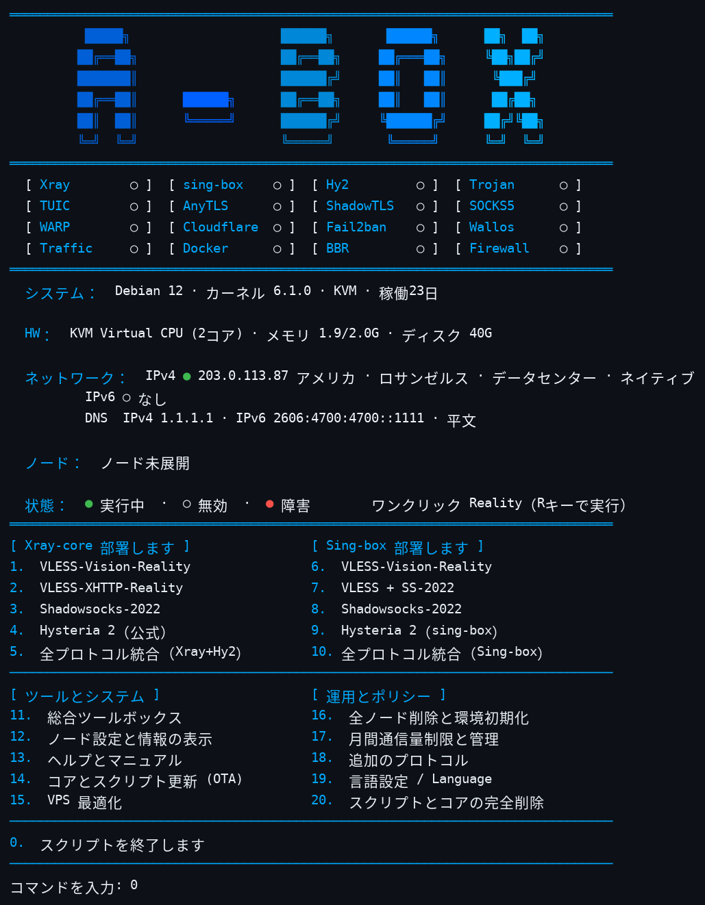
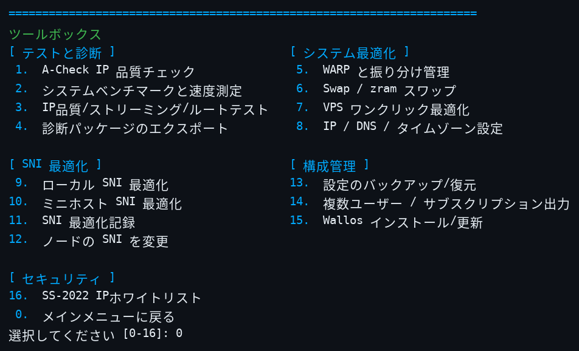
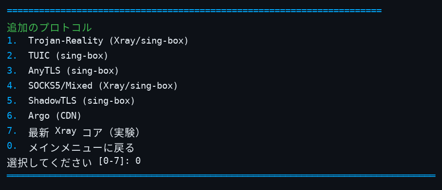

<div align="center">
  
  <p><b>Linux ネットワークサービスの一括導入・管理ツールキット</b> — 単一ファイルの Bash スクリプト · Xray / sing-box / Hysteria 2 · 6言語メニュー</p>
  <p>
    
    
    
  </p>
  <p>
    <a href="README.md">English</a> ·
    <a href="README-zh.md">简体中文</a> ·
    <a href="README-zh-tw.md">繁體中文</a> ·
    <a href="README-ja.md">日本語</a> ·
    <a href="README-ru.md">Русский</a> ·
    <a href="README-fa.md">فارسی</a>
  </p>
</div>

---

## スクリーンショット

メインメニュー（ステータスマトリクス、システム/ネットワーク情報、導入メニュー）：



ツールボックス（メニュー 11）：



その他のプロトコル（メニュー 18）：



## 概要

A-Box は単一ファイルの Bash スクリプト（`install.sh`、約30,000行）で、Linux VPS 上のプロキシおよびネットワークサービスの導入と保守を行います。Xray、sing-box、公式 Hysteria 2 サーバーのインストールと設定、クライアント設定の生成に加え、ファイアウォールルール、Fail2Ban、DNS 設定、バックアップ、アップグレード、診断といった日常運用を、6言語対応の対話型メニューにまとめています。メニューで選択するまで何も導入されず、破壊的な操作では必ず確認を求めます。

## クイックスタート

公式ソース（不変のコミットに固定）：

```bash
curl -fsSL https://raw.githubusercontent.com/alariclin/A-Box/d2e8e55764e067af8219999902b1ac885911f8cd/install.sh -o A-Box.sh && sudo bash A-Box.sh
```

サードパーティミラー（同じ固定ファイルの転送経路であり、公式の入口ではありません）。直接実行せず、ダウンロードして公式ソースとバイト単位で照合し、一致してから実行してください。ミラーはプロキシを信頼できる場合にのみ使用し、未検証のミラーファイルを本番で実行しないでください：

```bash
curl -fsSL https://gh-proxy.com/https://raw.githubusercontent.com/alariclin/A-Box/d2e8e55764e067af8219999902b1ac885911f8cd/install.sh -o A-Box.sh &&
curl -fsSL https://raw.githubusercontent.com/alariclin/A-Box/d2e8e55764e067af8219999902b1ac885911f8cd/install.sh -o A-Box.official.sh &&
cmp A-Box.sh A-Box.official.sh && sudo bash A-Box.sh
```

- 新規の Alpine では、先に `apk add --no-cache bash curl sudo` を実行してください。
- 初回実行後は `sb` と入力すればメニューを再度開けます。
- 本番利用の前に、ダウンロードしたファイルを独立した信頼できる経路で確認してください。

## メインメニュー

| No. | Xray コア | No. | sing-box |
|---:|---|---:|---|
| 1 | VLESS-Vision-Reality | 6 | VLESS-Vision-Reality |
| 2 | VLESS-XHTTP-Reality | 7 | VLESS + SS-2022 |
| 3 | Shadowsocks-2022 | 8 | Shadowsocks-2022 |
| 4 | Hysteria 2（公式サーバー） | 9 | Hysteria 2（Sing-box） |
| 5 | オールインワン（Xray+Hy2） | 10 | オールインワン（Sing-box） |

Xray のオールインワンは Vision（TCP 443）、XHTTP（TCP 8443）、Shadowsocks-2022（TCP/UDP 2053）、Hysteria 2（UDP 443）の組み合わせです。sing-box のオールインワンは Vision、Shadowsocks-2022、Hysteria 2 の組み合わせで、XHTTP は含みません。

| No. | ツールとシステム | No. | 運用 |
|---:|---|---:|---|
| 11 | ツールボックス | 16 | ノード消去と環境リセット（単一削除/全削除/環境リセット） |
| 12 | ノード設定とリンクの表示 | 17 | 月間トラフィック制限 |
| 13 | ユーザーガイドとマニュアル | 18 | その他のプロトコル（下記サブメニュー） |
| 14 | コアとスクリプトの更新（OTA） | 19 | 言語設定 |
| 15 | VPS 一括最適化 | 20 | スクリプトとコアのアンインストール |
| 0 | 終了 | R | ワンクリック Reality（ショートカットキー） |

### その他のプロトコル（メニュー 18）

上記の統合パッケージとは独立した単体導入です。各プロトコルとも、ポートを尋ね、パスワードを生成または受け付け、書き込み前にコアで設定を検証し、共有リンクをメニュー 12 に登録し、終了時に Fail2Ban ルールを更新します。SNI を使うプロトコルでは、導入時に Enter で自動優選するかドメインを手入力するか選べます。導入済みノードの SNI はツールボックス（12）で変更できます。

| No. | プロトコル | 説明 |
|---:|---|---|
| 1 | Trojan-Reality | 単体 Trojan + REALITY。Xray / sing-box コアを選択可能 |
| 2 | TUIC | sing-box の TUIC v5、UDP、自己署名証明書 |
| 3 | AnyTLS | sing-box の AnyTLS、REALITY 付き |
| 4 | SOCKS5 / Mixed | 認証付き単体 SOCKS5。コアを選択可能 |
| 5 | ShadowTLS | sing-box の ShadowTLS v3、内部の Shadowsocks-2022 インバウンドへ迂回 |
| 6 | Argo (CDN) | VMess / VLESS を WebSocket で Cloudflare トンネル経由にし、サーバー側のインバウンドポートを開きません。一時トンネルはランダムな `*.trycloudflare.com` アドレスで再起動ごとに変わります。固定トンネルは自分のドメインとトンネルトークンを使用します |
| 7 | 最新 Xray | 実験機能：upstream 最新の Xray コアをインストール（スロット乗っ取り、またはポート競合警告付きで xray-latest として並行）し、VLESS-Vision / XHTTP / Trojan-Reality / SS-2022 / SOCKS5 を個別に導入できるほか、ワンクリック三点・四点セット（+ 公式 Hy2）とマシン全体のポート競合警告を含みます。失敗時は理由を表示してその導入を削除し、安定版を自動で再インストールすることはありません。 |

## ステータスパネル

メニュー上部には16セルのステータスマトリクス（実行中 / 未開始 / 異常）が表示されます：Xray、sing-box、Hy2、Trojan、TUIC、AnyTLS、ShadowTLS、SOCKS5、WARP、Cloudflare、Fail2ban、Wallos、Traffic、Docker、BBR、Firewall。その下にシステム、ハードウェア、ネットワークの情報行が続きます。ネットワーク行には出口 IP の位置と種別（データセンター / 住宅 / モバイル、エニーキャストかネイティブか）が表示されます。導入済みノードはポートと SNI とともに一覧表示されます。緑のセルはサービスが動作中かポートがリッスン中であることを示すだけで、エンドツーエンドの接続性を保証するものではありません。クライアントで実測してください。その下のユーザー欄には、ノードごとにアクティブなユーザーの使用量（M/G 単位）と、設定済みの上限・有効期限が表示されます。ブロック済み・無効化済みのユーザーはパネルに表示されず、ツールボックス（14）でのみ管理します。

## ツールボックス（メニュー 11）

| No. | 機能 | No. | 機能 |
|---:|---|---:|---|
| 1 | A-Check IP 品質チェック | 9 | ローカル SNI 最適化 |
| 2 | システムベンチマークと速度測定 | 10 | ミニホスト SNI 最適化 |
| 3 | IP品質 / ストリーミング / ルートテスト | 11 | SNI テスト記録 |
| 4 | 診断パッケージのエクスポート | 12 | ノード SNI の変更 |
| 5 | WARP と振り分け管理 | 13 | 設定のバックアップ / 復元 |
| 6 | スワップメモリ（zram / Swap）| 14 | 複数ユーザー / サブスクリプション出力 |
| 7 | VPS ワンクリック最適化 | 15 | Wallos インストール / 更新 / バックアップ |
| 8 | IP / DNS / タイムゾーン設定 | 16 | SS-2022 アクセス許可リスト |
| 0 | メインメニューに戻る | | |

項目 2・3 のテストスクリプトは、デフォルトで上流の最新版を取得し構造チェックを行います。取得またはチェックに失敗した場合は、検証済み `test-tools-mirror` リリース内の固定コピー（Ed25519 署名 + SHA-256 の二重検証）にフォールバックし、両方とも利用できない場合は何も実行しません。項目 1 の A-Check も同様に最新版をリアルタイム取得し、失敗時は署名済みミラーの固定コピー、次にローカルの検証済みキャッシュへフォールバックします。

項目 1 の **A-Check** は、姉妹プロジェクト [A-Check](https://github.com/alariclin/A-Check) の IP 評判チェッカーです。スクリプトは A-Check リポジトリから最新版をリアルタイム取得し、実行前に構造チェック（shebang、VERSION マーカー、サイズ、py_compile）を行って `/etc/ddr/tools` にキャッシュします。取得に失敗した場合は、署名検証済みのミラー固定コピー、次にローカルの検証済みキャッシュへフォールバックします。Python 3.8 以上が必要です。

**ユーザー管理（ツールボックス 14)。** デプロイ済みのすべてのノード（組み合わせ・単独プロトコルを問わず、Xray / sing-box / Latest Xray インスタンス / 公式 Hysteria 2）には、名前付きユーザーを複数追加でき、各ユーザーに専用の認証情報と共有リンク / QR コードが付きます。ユーザーごとに月間流量制限 (GB)、有効期限（日数）、利用可能時間帯を設定でき、5 分ごとのバックグラウンドチェックが自動執行します。期限切れ・制限超過・時間帯外のユーザーは自動的に失効します（Xray 系では再起動なしのホット失効）。ユーザー別統計と制限執行は Xray 系（StatsService）でのみ利用可能で、sing-box 公式バイナリにはユーザー別統計がないため、sing-box では期限と時間帯のルールのみが効きます。全ユーザーのリンクは購読ファイルとして一括エクスポートできます。

**同一プロトコルの複数インスタンス。** 単独プロトコルがすでにそのコアに存在する場合、デプロイ入口で「インスタンスを追加」を選べます。追加分は独自のポート・認証情報・ユーザーリストを持ち（タグ接尾辞 -2、-3 …)、独立して管理・削除できます。

## サブシステム

**クライアント設定。** 導入のたびに共有リンクと QR コードを表示します。メニュー 12 では、メニュー 18 の単体プロトコルを含め、すべてのノードパラメータとリンクをいつでも再表示でき、Clash / Mihomo YAML、sing-box JSON、v2rayN / v2rayNG 設定をエクスポートできます。サーバー側で複数の UUID を追加・失効でき、ユーザーごとにエクスポートできます。共有リンクとエクスポートファイルのノード名はプロトコル名のみ（Vision、XHTTP、SS、Hy2、Trojan-Reality など）で、ブランド接頭辞は付きません。

**WARP と振り分け。** Cloudflare WARP をネイティブの WireGuard アウトバウンドとしてワンクリックで導入します。ストリーミング、CN 直結、グローバルの3プリセットに加え、カスタムのドメイン振り分けルールと複数ホストの SOCKS5 アウトバウンドに対応します。

**DNS 設定。** 自動実測では、実際のクエリで平文 DNS、DoT、DoH それぞれ最速のリゾルバを選びます。そのほか手動入力、Cloudflare / Quad9 のプリセット、変更前スナップショットへのロールバック、3モード設定（IPv4 のみ / IPv6 のみ / デュアルスタック）があります。DoT は systemd-resolved 経由、DoH はローカルの dnscrypt-proxy 転送で動作します。

**Wallos。** オプションのセルフホスト型サブスクリプション管理ツール（Docker）。インストール時にアクセス方法を選びます：公開 HTTPS（Caddy が Let's Encrypt の IP 証明書を終端し自動更新。失敗した場合は確認のうえでのみ次の方式にフォールバック）、ローカルのみ + SSH トンネル、自分のドメインを使う Cloudflare トンネル、または公開平文 HTTP（フォールバック用）。ステータス表示、データベースのヘルスチェック、tar バックアップを備えます。

**能動的防御。** Fail2Ban が無いシステムには自動でインストールします。その jail は SSH に加え、現在の Xray / sing-box 設定から収集したすべての公開ポートを対象にします——直近の導入分だけではありません——また BAN 時間は段階的に延びます。Wallos にはログイン入口専用の jail があります。

**高速モード。** `ABOX_FAST=1` を設定すると、導入中の繰り返しの確認プロンプトが省略されます。

**バックアップ、アップグレード、OTA。** 設定のバックアップ/復元は、バージョン付きマニフェスト形式と復旧キー（`--export-backup-key`）を使います。コアのアップグレードでは既存のノードパラメータが保持されます。スクリプト自体の OTA 更新は SHA-256 を表示し、明示的な確認を求めます。Xray の Geo データは個別に更新できます。

**コアバージョン。** Xray は `v26.7.28` に固定されています：Xray ≥ v26.9.8 は X25519MLKEM768 鍵交換を要求し、sing-box クライアントは現時点ではそのハンドシェイクを完了できません。sing-box と Hysteria は既定で最新の公式安定版に追随し（7 日間のクールダウン、検証後に採用）、互換ピン `v1.14.3` / `app/v2.13.0` はフォールバックです。Argo 用の cloudflared は `2026.10.2`、Wallos の HTTPS フロントエンド Caddy は `2.11.7` に固定され、いずれも SHA-256 で検証します。コアバイナリはリリースのマニフェストで SHA-256 を照合し、署名が公開されているものは Ed25519 署名検証を強制します（`docs/SIGNING.md` 参照）。固定版と各バージョンの最新安定版は、ロールバック用に `core-binaries` リリースに保持されています。

**SNI 候補。** リポジトリには 4,158 件の候補ドメインのシードリスト（`data/sni-candidates.txt`）が含まれます。ツールボックスで対象 VPS から実測して選定（フル版またはミニ版）し、結果を記録できます。リストに載っていることは候補であるという意味にすぎず、そのネットワークで使えることや、特定の REALITY 導入に適することを保証しません。有効なリストが得られない場合、この処理は失敗として終了します。

## コマンドライン

| コマンド | 用途 |
|---|---|
| `sudo bash A-Box.sh` | 対話型メニューを開く |
| `sudo bash A-Box.sh --help` | コマンドラインヘルプを表示 |
| `sudo bash A-Box.sh --lang zh` / `zh-tw` / `en` / `ja` / `ru` / `fa` | UI 言語を指定して起動 |
| `sudo bash A-Box.sh --self-test` | 内蔵セルフテストを実行 |
| `sudo bash A-Box.sh --status` | 管理対象サービスと設定の状態を表示 |
| `sudo bash A-Box.sh --start` / `--stop` | 管理対象サービスを起動 / 停止 |
| `sudo bash A-Box.sh --version` | スクリプトのビルド識別子を表示 |
| `sudo bash A-Box.sh --export-backup-key /secure/path.key` | バックアップ復旧キーをエクスポート |
| `sudo bash A-Box.sh --convert-legacy-backup OLD.tar.gz [DIR]` | 旧形式のバックアップを現行形式に変換 |

セルフテストの合格は、実際のインストール、クライアント接続確認の代わりにはなりません。

## システム要件

実測済みシステム（14）：Debian 10 / 11 / 12 / 13、Ubuntu 20.04 / 22.04 / 24.04、Rocky Linux 8 / 9、AlmaLinux 8 / 9、Fedora 40、Alpine 3.18 / 3.19。

| 項目 | 要件 |
|---|---|
| init システム | systemd または OpenRC |
| CPU | amd64 / x86_64 または arm64 / aarch64 |
| 権限 | root、または sudo |
| ネットワーク | OS のパッケージリポジトリと GitHub / 上流のリリースエンドポイントへアクセスできること。導入するポートに到達できること（クラウド事業者のファイアウォールでも開放が必要） |

## 注意事項

- パネルの IP 種別と位置データは公開の IP インテリジェンスサービス由来で、まれに誤ることがあります。複数ソースの照合で誤りは減りますが、完全にはなくなりません。
- Let's Encrypt の IP 証明書（Wallos HTTPS モード）は有効期間が短く（約160時間）、Caddy が自動更新します。公開信頼された証明書と同様、公開の Certificate Transparency ログに記録されます。
- Argo の一時トンネルアドレスは cloudflared の再起動ごとに変わります。固定アドレスが必要な場合は、自分のドメインで固定トンネルを使ってください。
- BBR/FQ チューニング、DNS 変更、WARP の振り分けは、選択したときにのみ適用されます。DNS とチューニングの変更にはロールバック経路があります。
- バックアップと復旧キーは、独立した保護された場所に保管してください。

## 準拠と免責

本プロジェクトは、自分が所有・管理するか、明示的な許可を得たサーバー、ネットワーク、システムでのみ使用し、適用される法令——暗号化、プロキシ、ネットワークアクセスに関する地域の規則を含む——を守ってください。想定用途は、許可された環境でのシステム管理、ネットワークテスト、研究です。無許可のアクセス、攻撃、濫用、正当な監督の回避には使用しないでください。

本ソフトウェアは「現状のまま」提供され、いかなる保証もありません。実行前にスクリプトの内容を確認し、保守やアップグレードの前には復旧可能なバックアップを取ってください。利用に伴う法的・運用的・セキュリティ上の結果は利用者の責任です。

## フィードバックとライセンス

- 問題報告：[GitHub Issues](https://github.com/alariclin/A-Box/issues)
- 本プロジェクトは [Apache License 2.0](LICENSE) で公開されています。
