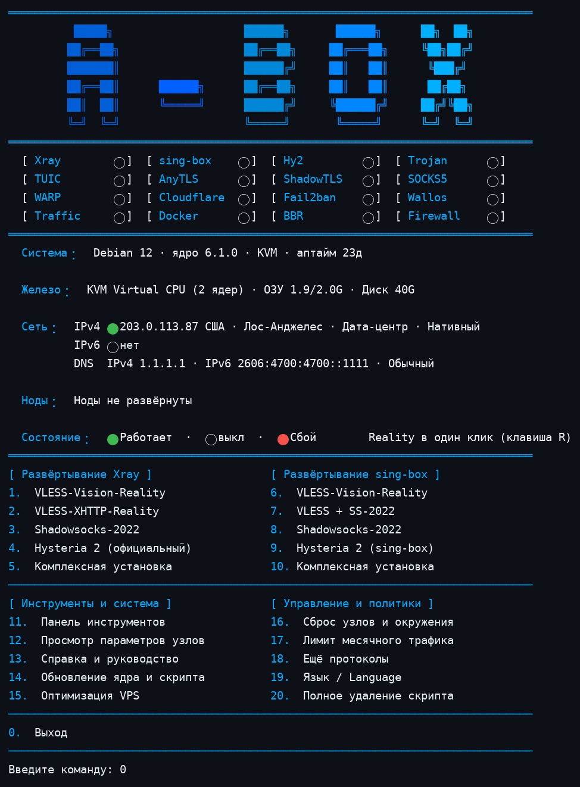
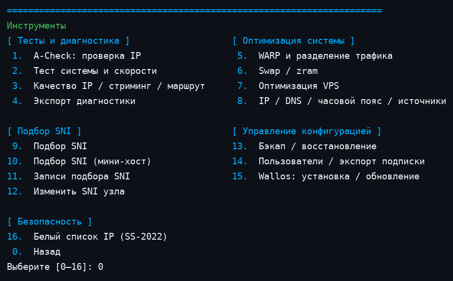
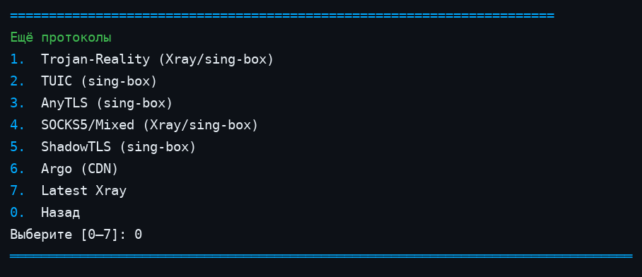

<div align="center">
  
  <p><b>Инструментарий для развёртывания и обслуживания сетевых служб Linux одной командой</b> — один Bash-скрипт · Xray / sing-box / Hysteria 2 · меню на шести языках</p>
  <p>
    
    
    
  </p>
  <p>
    <a href="README.md">English</a> ·
    <a href="README-zh.md">简体中文</a> ·
    <a href="README-zh-tw.md">繁體中文</a> ·
    <a href="README-ja.md">日本語</a> ·
    <a href="README-ru.md">Русский</a> ·
    <a href="README-fa.md">فارسی</a>
  </p>
</div>

---

## Снимок экрана

Главное меню (матрица состояний, информация о системе и сети, меню развёртывания):



Панель инструментов (меню 11):



Дополнительные протоколы (меню 18):



## Что это

A-Box — это один Bash-скрипт (`install.sh`, около 30 000 строк), который развёртывает и обслуживает прокси и сетевые службы на Linux VPS. Он устанавливает и настраивает Xray, sing-box и официальный сервер Hysteria 2, создаёт клиентские конфигурации и объединяет повседневные операции — правила межсетевого экрана, защиту Fail2Ban, настройки DNS, резервные копии, обновления и диагностику — в одном интерактивном меню на шести языках. Пока вы не выберете пункт меню, ничего не разворачивается, а разрушительные действия требуют подтверждения.

## Быстрый старт

Официальный источник, команда закреплена за неизменяемым коммитом:

```bash
curl -fsSL https://raw.githubusercontent.com/alariclin/A-Box/67e4eb2da98073c6fa6bac8526c49953b5896978/install.sh -o A-Box.sh && sudo bash A-Box.sh
```

Стороннее зеркало того же закреплённого файла (только канал доставки, не официальный адрес). Не запускайте его напрямую: скачайте, побайтово сверьте с официальным источником и только потом запускайте. Используйте зеркало только если доверяете прокси; непроверенный файл из зеркала нельзя использовать в рабочей среде:

```bash
curl -fsSL https://gh-proxy.com/https://raw.githubusercontent.com/alariclin/A-Box/67e4eb2da98073c6fa6bac8526c49953b5896978/install.sh -o A-Box.sh &&
curl -fsSL https://raw.githubusercontent.com/alariclin/A-Box/67e4eb2da98073c6fa6bac8526c49953b5896978/install.sh -o A-Box.official.sh &&
cmp A-Box.sh A-Box.official.sh && sudo bash A-Box.sh
```

- В новой системе Alpine сначала выполните `apk add --no-cache bash curl sudo`.
- После первого запуска меню снова открывается командой `sb`.
- Перед использованием в рабочей среде проверьте загруженный файл по независимому доверенному каналу.

## Главное меню

| № | Ядро Xray | № | sing-box |
|---:|---|---:|---|
| 1 | VLESS-Vision-Reality | 6 | VLESS-Vision-Reality |
| 2 | VLESS-XHTTP-Reality | 7 | VLESS + SS-2022 |
| 3 | Shadowsocks-2022 | 8 | Shadowsocks-2022 |
| 4 | Hysteria 2 (официальный сервер) | 9 | Hysteria 2 (Sing-box) |
| 5 | Всё в одном (Xray + Hy2) | 10 | Всё в одном (Sing-box) |

Комплект Xray объединяет Vision (TCP 443), XHTTP (TCP 8443), Shadowsocks-2022 (TCP/UDP 2053) и Hysteria 2 (UDP 443). Комплект sing-box объединяет Vision, Shadowsocks-2022 и Hysteria 2; XHTTP в него не входит.

| № | Инструменты и система | № | Эксплуатация |
|---:|---|---:|---|
| 11 | Панель инструментов | 16 | Сброс узлов и среды (удалить один / все / сброс) |
| 12 | Просмотр конфигураций и ссылок узлов | 17 | Месячная квота трафика |
| 13 | Руководство пользователя | 18 | Дополнительные протоколы (подменю ниже) |
| 14 | Обновление ядер и скрипта (OTA) | 19 | Настройки языка |
| 15 | Оптимизация VPS | 20 | Удаление скрипта и ядер |
| 0 | Выход | R | Reality одной клавишей (горячая клавиша) |

### Дополнительные протоколы (меню 18)

Отдельные развёртывания, независимые от комплектов выше. Каждый протокол спрашивает порт, создаёт или принимает пароль, проверяет конфигурацию ядром до её записи, регистрирует свою ссылку в меню 12 и по завершении обновляет правила Fail2Ban. Для протоколов с SNI при развёртывании можно нажать Enter для автоматического подбора или ввести домен вручную; SNI уже развёрнутого узла меняется в панели инструментов (п. 12).

| № | Протокол | Описание |
|---:|---|---|
| 1 | Trojan-Reality | Отдельный Trojan с REALITY; ядро Xray или sing-box на выбор |
| 2 | TUIC | TUIC v5 на sing-box, UDP, самоподписанный сертификат |
| 3 | AnyTLS | AnyTLS на sing-box, с REALITY |
| 4 | SOCKS5 / Mixed | Отдельный SOCKS5 с аутентификацией; ядро на выбор |
| 5 | ShadowTLS | ShadowTLS v3 на sing-box, с переходом на внутренний вход Shadowsocks-2022 |
| 6 | Argo (CDN) | VMess / VLESS по WebSocket через туннель Cloudflare — входящий порт на сервере не открывается. Временные туннели получают случайный адрес `*.trycloudflare.com`, который меняется при перезапуске; постоянные туннели используют ваш домен и токен туннеля |
| 7 | Последний Xray | Эксперимент: установка новейшего ядра Xray из upstream (занять слот или параллельно как экземпляр xray-latest с предупреждением о конфликте портов); поочерёдное развёртывание VLESS-Vision / XHTTP / Trojan-Reality / SS-2022 / SOCKS5, комбинации трио и квад (+ официальный Hy2) в один клик и предупреждение о конфликте портов по всей машине. При сбое причина показывается, попытка удаляется; стабильное ядро автоматически не переустанавливается. |

## Панель состояния

В верхней части меню — матрица из 16 ячеек (работает / не запущено / неисправно): Xray, sing-box, Hy2, Trojan, TUIC, AnyTLS, ShadowTLS, SOCKS5, WARP, Cloudflare, Fail2ban, Wallos, Traffic, Docker, BBR и Firewall. Ниже — строки о системе, оборудовании и сети. В сетевой строке указаны местоположение и тип исходящего IP (дата-центр / резидентный / мобильный, anycast или нативный). Установленные узлы перечислены с их портами и SNI. Зелёная ячейка означает только, что служба работает или порт слушается; это не проверка сквозной связности — проверяйте клиентом. Ниже — раздел пользователей: по каждому узлу перечислены активные пользователи с их собственным трафиком (в единицах M/G), лимитом и сроком, если заданы; заблокированные и отключённые пользователи на панели не показываются — они управляются в панели инструментов (п. 14).

## Панель инструментов (меню 11)

| № | Функция | № | Функция |
|---:|---|---:|---|
| 1 | A-Check: проверка IP | 9 | Локальный подбор SNI |
| 2 | Бенчмарк системы и тест скорости загрузки | 10 | Подбор SNI для мини-хостов |
| 3 | Тест качества IP / стриминга / маршрутов | 11 | Записи тестов SNI |
| 4 | Экспорт обезличенной диагностики | 12 | Изменение SNI узла |
| 5 | WARP и раздельная маршрутизация | 13 | Резервная копия / восстановление конфигурации |
| 6 | Память подкачки (zram / Swap) | 14 | Экспорт для нескольких пользователей / подписки |
| 7 | Оптимизация VPS одной командой | 15 | Wallos: установка / обновление / резервная копия |
| 8 | Настройки IP / DNS / часового пояса / источников | 16 | Белый список доступа SS-2022 |
| 0 | Назад в главное меню | | |

Тестовые скрипты (пункты 2–3) по умолчанию загружают актуальную версию с upstream и проходят структурную проверку. Если загрузка или проверка не удалась, используется закреплённая копия из проверенного релиза `test-tools-mirror` (двойная проверка: подпись Ed25519 + SHA-256); если недоступны оба источника, ничего не выполняется. A-Check (пункт 1) также получает актуальную версию в реальном времени, а при неудаче откатывается сначала к подписанной зеркальной копии, затем к последнему проверенному локальному кэшу.

Пункт 1, **A-Check**, — это проверка репутации IP из сопутствующего проекта [A-Check](https://github.com/alariclin/A-Check). Скрипт получает актуальную версию из репозитория A-Check в реальном времени, перед запуском проверяет её структуру (shebang, маркер VERSION, размер, py_compile) и кэширует в `/etc/ddr/tools`; при неудаче получения откатывается сначала к закреплённой зеркальной копии с проверенной подписью, затем к последнему проверенному локальному кэшу. Требуется Python 3.8 или новее.

**Управление пользователями (панель инструментов, п. 14).** Каждый развёрнутый узел — комбинированный или отдельный протокол, на Xray, sing-box, экземпляре Latest Xray и официальном Hysteria 2 — может иметь несколько именованных пользователей, у каждого свои доступ, ссылка и QR-код. Для пользователя задаются месячный лимит трафика (ГБ), срок действия (в днях) и разрешённое расписание. Фоновая проверка каждые 5 минут применяет правила автоматически: просроченные, превысившие лимит и находящиеся вне расписания пользователи отключаются (на ядрах Xray — «горячо», без перезапуска). Статистика по пользователям и лимиты действуют в семействе Xray (StatsService); официальный sing-box такой статистики не предоставляет, поэтому на sing-box работают только срок и расписание. Ссылки всех пользователей экспортируются разом в файлы подписки.

**Несколько экземпляров одного протокола.** Если отдельный протокол уже есть на ядре, при развёртывании предлагается «добавить ещё экземпляр»: у копии свои порт, доступ и список пользователей (суффиксы тегов -2, -3, ...), она управляется и удаляется независимо.

## Подсистемы

**Клиентские конфигурации.** Каждое развёртывание выводит ссылку для подключения и QR-код. В меню 12 в любой момент можно снова увидеть все параметры и ссылки узлов — включая отдельные протоколы из меню 18 — и экспортировать конфигурации Clash / Mihomo YAML, sing-box JSON и v2rayN / v2rayNG. На сервере можно добавлять и отзывать несколько UUID с экспортом по пользователям. Имена узлов в ссылках и экспортируемых файлах — только название протокола (Vision, XHTTP, SS, Hy2, Trojan-Reality и т. д.), без фирменного префикса.

**WARP и раздельная маршрутизация.** Выход через Cloudflare WARP как нативный исходящий WireGuard в один клик: пресеты для стриминга, прямых соединений с CN и глобальный, а также пользовательские правила маршрутизации по доменам и исходящие SOCKS5 с несколькими хостами.

**Настройки DNS.** Автоматический замер выбирает самый быстрый резолвер по реальным запросам — отдельно для обычного DNS, DoT и DoH. Также есть ручной ввод, пресеты Cloudflare / Quad9, откат к снимку конфигурации до изменений и трёхрежимная настройка стека (только IPv4 / только IPv6 / двойной стек). DoT работает через systemd-resolved; DoH — через локальную пересылку dnscrypt-proxy.

**Wallos.** Необязательный трекер подписок для собственного хостинга (Docker). При установке выбирается способ доступа: публичный HTTPS с IP-сертификатом Let's Encrypt, завершаемым Caddy (автопродление; при неудаче переход к следующему способу — только с вашего подтверждения), доступ только локально через SSH-туннель, туннель Cloudflare на вашем домене или публичный HTTP без шифрования как запасной вариант. Есть страница состояния, проверка здоровья базы данных и резервные копии в tar.

**Активная защита.** Если Fail2Ban в системе нет, он устанавливается автоматически. Его jail охватывают SSH и все публичные порты, собранные из действующих конфигураций Xray / sing-box, — а не только порты последнего развёртывания, — со ступенчатым увеличением времени блокировки. У Wallos есть собственный jail на его входе для авторизации.

**Быстрый режим.** При заданной переменной `ABOX_FAST=1` повторяющиеся запросы подтверждения при развёртывании пропускаются.

**Резервные копии, обновления, OTA.** Резервное копирование и восстановление конфигурации используют версионированный манифест и ключ восстановления (`--export-backup-key`). Обновление ядер сохраняет существующие параметры узлов; собственное OTA-обновление скрипта показывает SHA-256 и требует явного подтверждения. Геоданные Xray можно обновлять отдельно.

**Версии ядер.** Xray закреплён за `v26.7.28`: Xray ≥ v26.9.8 требует обмена ключами X25519MLKEM768, который клиенты sing-box пока завершить не могут. sing-box и Hysteria по умолчанию следуют за последним официальным стабильным релизом (7-дневное охлаждение, проверка перед применением), а совместимые закрепления `v1.14.3` / `app/v2.13.0` остаются запасным вариантом; cloudflared для Argo закреплён за `2026.10.2`, а Caddy для HTTPS-фронтенда Wallos — за `2.11.7`, оба с проверкой SHA-256. Бинарные файлы ядер сверяются с манифестами SHA-256 релизов, а там, где опубликованы подписи, принудительно проверяется подпись Ed25519 (см. `docs/SIGNING.md`). Закреплённые версии и версионированные последние стабильные сборки хранятся в релизе `core-binaries` для отката.

**Кандидаты SNI.** В репозитории есть стартовый список из 4 158 доменов-кандидатов (`data/sni-candidates.txt`). Панель инструментов может проверить их с целевого VPS (полный или мини-тест) и сохраняет результаты. Домен из списка — только кандидат: это не гарантия, что он заработает в вашей сети или подойдёт для конкретного развёртывания REALITY. Если получить действительный список не удалось, процедура завершается ошибкой.

## Командная строка

| Команда | Назначение |
|---|---|
| `sudo bash A-Box.sh` | Открыть интерактивное меню |
| `sudo bash A-Box.sh --help` | Показать справку по командной строке |
| `sudo bash A-Box.sh --lang zh` / `zh-tw` / `en` / `ja` / `ru` / `fa` | Запуск с заданным языком интерфейса |
| `sudo bash A-Box.sh --self-test` | Запустить встроенные самотесты |
| `sudo bash A-Box.sh --status` | Показать состояние управляемых служб и конфигурации |
| `sudo bash A-Box.sh --start` / `--stop` | Запустить или остановить управляемые службы |
| `sudo bash A-Box.sh --version` | Показать идентификатор сборки скрипта |
| `sudo bash A-Box.sh --export-backup-key /secure/path.key` | Экспортировать ключ восстановления резервных копий |
| `sudo bash A-Box.sh --convert-legacy-backup OLD.tar.gz [DIR]` | Преобразовать резервную копию старого формата в текущий |

Пройденный самотест не заменяет реальную установку или проверку связности клиентом.

## Системные требования

Проверенные системы (14): Debian 10 / 11 / 12 / 13, Ubuntu 20.04 / 22.04 / 24.04, Rocky Linux 8 / 9, AlmaLinux 8 / 9, Fedora 40, Alpine 3.18 / 3.19.

| Параметр | Требование |
|---|---|
| Система инициализации | systemd или OpenRC |
| CPU | amd64 / x86_64 или arm64 / aarch64 |
| Права | root или sudo |
| Сеть | Доступ к репозиториям пакетов ОС и к GitHub / конечным точкам релизов; разворачиваемые порты должны быть достижимы (их также нужно открыть в межсетевом экране облачного провайдера) |

## Примечания

- Данные о типе и местоположении IP на панели поступают из публичных служб IP-аналитики и иногда ошибочны; сверка по нескольким источникам уменьшает, но не устраняет ошибки.
- IP-сертификаты Let's Encrypt (режим HTTPS у Wallos) недолговечны (около 160 часов) и автоматически продлеваются Caddy; они попадают в публичные журналы Certificate Transparency, как и все публично доверенные сертификаты.
- Адреса временных туннелей Argo меняются при каждом перезапуске cloudflared. Для постоянного адреса используйте постоянный туннель на своём домене.
- Настройка BBR/FQ, изменения DNS и маршрутизация WARP применяются только при вашем выборе; для изменений DNS и настройки предусмотрен откат.
- Храните резервные копии и ключ восстановления в отдельном защищённом месте.

## Соответствие требованиям и отказ от ответственности

Используйте этот проект только на серверах, в сетях и системах, которые принадлежат вам, находятся под вашим управлением или на работу с которыми у вас есть явное разрешение, и только в соответствии с применимыми законами и нормами, включая местные правила о шифровании, проксировании и доступе к сети. Проект предназначен для системного администрирования, сетевого тестирования и исследований в разрешённых средах. Не используйте его для несанкционированного доступа, атак, злоупотреблений или обхода законного надзора.

Программное обеспечение предоставляется «как есть», без каких-либо гарантий. Перед запуском ознакомьтесь со скриптом, а перед обслуживанием или обновлением делайте восстановимые резервные копии. Юридические, эксплуатационные и связанные с безопасностью последствия использования несёте вы.

## Обратная связь и лицензия

- Сообщения о проблемах: [GitHub Issues](https://github.com/alariclin/A-Box/issues)
- Проект опубликован под лицензией [Apache License 2.0](LICENSE).
