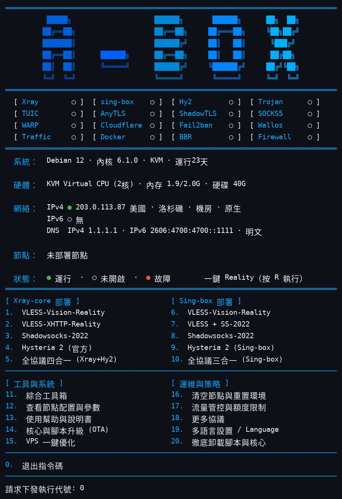
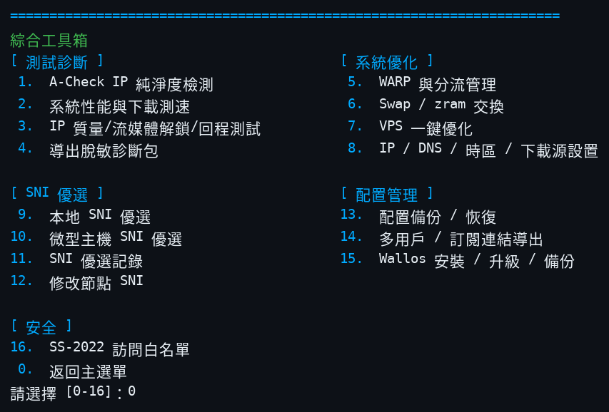
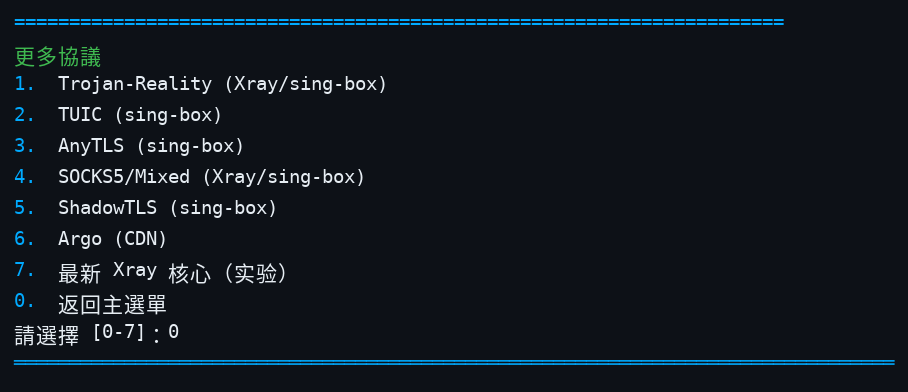

<div align="center">
  
  <p><b>Linux 網路服務一鍵部署與管理工具箱</b> — 單一檔案 Bash 腳本 · Xray / sing-box / Hysteria 2 · 六種語言選單</p>
  <p>
    
    
    
  </p>
  <p>
    <a href="README.md">English</a> ·
    <a href="README-zh.md">简体中文</a> ·
    <a href="README-zh-tw.md">繁體中文</a> ·
    <a href="README-ja.md">日本語</a> ·
    <a href="README-ru.md">Русский</a> ·
    <a href="README-fa.md">فارسی</a>
  </p>
</div>

---

## 介面截圖

主選單（狀態矩陣、系統/網路資訊與部署選單）：



綜合工具箱（選單 11）：



更多協議（選單 18）：



## 這是什麼

A-Box 是一個單一檔案 Bash 腳本（`install.sh`，約 30,000 行），用於在 Linux VPS 上部署和維護代理與網路服務。它負責安裝和設定 Xray、sing-box 與官方 Hysteria 2 伺服器端，產生用戶端設定，並把日常維運——防火牆規則、Fail2Ban 防護、DNS 設定、備份、升級與診斷——收進一個六種語言的互動選單。你在選單裡選定之前，腳本不會部署任何東西；破壞性操作都會先要求確認。

## 快速開始

官方來源，指令已鎖定到不可變的提交：

```bash
curl -fsSL https://raw.githubusercontent.com/alariclin/A-Box/ad35dc859a3c36dbf15db2991fbbd1cb591b7183/install.sh -o A-Box.sh && sudo bash A-Box.sh
```

第三方鏡像（與上面是同一個鎖定檔案，僅作傳輸通道，不是官方入口）。不要直接執行：先下載，再與官方來源逐位元組比對，通過後才執行。僅在信任該代理時使用鏡像；未經核對的鏡像檔案不得用於生產：

```bash
curl -fsSL https://gh-proxy.com/https://raw.githubusercontent.com/alariclin/A-Box/ad35dc859a3c36dbf15db2991fbbd1cb591b7183/install.sh -o A-Box.sh &&
curl -fsSL https://raw.githubusercontent.com/alariclin/A-Box/ad35dc859a3c36dbf15db2991fbbd1cb591b7183/install.sh -o A-Box.official.sh &&
cmp A-Box.sh A-Box.official.sh && sudo bash A-Box.sh
```

- 全新的 Alpine 系統請先執行 `apk add --no-cache bash curl sudo`。
- 首次執行後，輸入 `sb` 即可再次開啟選單。
- 生產環境使用前，請透過獨立可信管道核對下載到的檔案。

## 主選單

| 編號 | Xray 核心 | 編號 | sing-box |
|---:|---|---:|---|
| 1 | VLESS-Vision-Reality | 6 | VLESS-Vision-Reality |
| 2 | VLESS-XHTTP-Reality | 7 | VLESS + SS-2022 |
| 3 | Shadowsocks-2022 | 8 | Shadowsocks-2022 |
| 4 | Hysteria 2（官方伺服器端） | 9 | Hysteria 2（Sing-box） |
| 5 | 全協議四合一（Xray+Hy2） | 10 | 全協議三合一（Sing-box） |

Xray 四合一包含 Vision（TCP 443）、XHTTP（TCP 8443）、Shadowsocks-2022（TCP/UDP 2053）與 Hysteria 2（UDP 443）。sing-box 三合一包含 Vision、Shadowsocks-2022 與 Hysteria 2，不含 XHTTP。

| 編號 | 工具與系統 | 編號 | 維運與策略 |
|---:|---|---:|---|
| 11 | 綜合工具箱 | 16 | 清空節點與重置環境（刪單個/清空全部/重置環境） |
| 12 | 查看節點配置與參數 | 17 | 流量管控與額度限制 |
| 13 | 使用幫助與說明書 | 18 | 更多協議（子選單見下） |
| 14 | 核心與腳本升級（OTA） | 19 | 多語言設定 |
| 15 | VPS 一鍵優化 | 20 | 徹底卸載腳本與核心 |
| 0 | 退出腳本 | R | 一鍵 Reality（快捷鍵） |

### 更多協議（選單 18）

獨立部署，與上面的組合部署互不影響。每個協議都會詢問連接埠、產生或接受密碼、寫入前先用核心校驗設定、把分享連結登記到選單 12，並在結束時刷新 Fail2Ban 規則。涉及 SNI 的協定在部署時可選：Enter 自動優選，或手填網域；已部署節點的 SNI 可在工具箱 12 修改。

| 編號 | 協議 | 說明 |
|---:|---|---|
| 1 | Trojan-Reality | 獨立 Trojan + REALITY，可選 Xray 或 sing-box 核心 |
| 2 | TUIC | sing-box 的 TUIC v5，UDP，自簽憑證 |
| 3 | AnyTLS | sing-box 的 AnyTLS，帶 REALITY |
| 4 | SOCKS5 / Mixed | 獨立 SOCKS5，帶帳號密碼認證，可選核心 |
| 5 | ShadowTLS | sing-box 的 ShadowTLS v3，轉接到內部 Shadowsocks-2022 入站 |
| 6 | Argo (CDN) | VMess / VLESS 經 WebSocket 走 Cloudflare 隧道，伺服器不開任何入站連接埠。臨時隧道是隨機 `*.trycloudflare.com` 位址，重新啟動即變；固定隧道用你自己的網域和隧道權杖 |
| 7 | 最新 Xray | 實驗功能：安裝上游最新版 Xray 核心（接管槽位，或以 xray-latest 實例並存並提示連接埠衝突），可逐個部署 VLESS-Vision / XHTTP / Trojan-Reality / SS-2022 / SOCKS5，也有一鍵三合一與一鍵四合一（+ 官方 Hy2），並提供整機連接埠衝突提醒。失敗會告知原因並刪除本次部署，絕不自動裝回穩定版核心。 |

## 狀態面板

選單頂部是 16 格狀態矩陣（運行 / 未開啟 / 故障）：Xray、sing-box、Hy2、Trojan、TUIC、AnyTLS、ShadowTLS、SOCKS5、WARP、Cloudflare、Fail2ban、Wallos、Traffic、Docker、BBR、Firewall，其後是系統、硬體與網路資訊行。網路行會標註出口 IP 的位置與類型（機房 / 住宅 / 蜂窩、任播或原生）。已部署節點會列出連接埠與 SNI。綠格只表示服務在運行或連接埠在監聽，不等於端到端連通，請以用戶端實測為準。其下是用戶區：按節點列出在用用戶各自的用量（只用 M/G 單位）、已設的限額與到期；封鎖或停用的用戶不在面板顯示，只在工具箱 14 裡管理。

## 綜合工具箱（選單 11）

| 編號 | 功能 | 編號 | 功能 |
|---:|---|---:|---|
| 1 | A-Check IP 純淨度檢測 | 9 | 本地 SNI 優選 |
| 2 | 系統效能與下載測速 | 10 | 微型主機 SNI 優選 |
| 3 | IP 品質 / 串流解鎖 / 回程測試 | 11 | SNI 優選記錄 |
| 4 | 匯出脫敏診斷包 | 12 | 修改節點 SNI |
| 5 | WARP 與分流管理 | 13 | 配置備份 / 還原 |
| 6 | 交換記憶體（zram / Swap）| 14 | 多用戶 / 訂閱連結匯出 |
| 7 | VPS 一鍵優化 | 15 | Wallos 安裝 / 升級 / 備份 |
| 8 | IP / DNS / 時區 / 下載源設定 | 16 | SS-2022 存取白名單 |
| 0 | 返回主選單 | | |

第 2、3 項的測試腳本預設拉取上游最新版並做結構校驗；拉取或校驗失敗時，回退到經校驗的 `test-tools-mirror` 發布中的釘版備份（Ed25519 簽名與 SHA-256 雙重校驗）；兩者都不可用時不執行任何腳本。第 1 項 A-Check 同樣即時拉取最新版，失敗時依序回退簽名鏡像釘版與本機已驗證快取。

第 1 項 **A-Check** 是配套專案 [A-Check](https://github.com/alariclin/A-Check) 的 IP 純淨度檢測工具。腳本從 A-Check 倉庫即時拉取最新版，運行前做結構校驗（shebang、VERSION 標記、大小、py_compile），並快取在 `/etc/ddr/tools`；即時拉取失敗時，依序回退到簽名校驗的鏡像釘版與本機已驗證快取。需要 Python 3.8 或更高版本。

**多用戶管理（工具箱 14)。** 每個已部署的節點——組合與獨立協定均可，涵蓋 Xray、sing-box、Latest Xray 實例與 Hy2 官方版——都能新增多個命名用戶，每人獨立憑據、獨立分享連結與 QR 碼。可按用戶設定每月流量限額 (GB)、到期天數與可用時段；背景每 5 分鐘檢查一次並自動執行：到期、超限額或時段外的用戶會被自動撤銷（Xray 家族為熱撤銷、無需重啟）。按用戶流量統計與限額執行僅 Xray 家族可用 (StatsService)；sing-box 官方版無按用戶統計，該核心上僅到期與時段規則生效。全部用戶連結可一鍵匯出為訂閱檔案。

**同協定多實例。** 某獨立協定在某核心上已存在時，其部署入口會提供「新增一個實例」：新實例有獨立的埠、憑據與用戶名單（標籤後綴 -2、-3……），可獨立管理與刪除。

## 子系統

**用戶端配置。** 每次部署都會列印分享連結和 QR 碼。選單 12 隨時可重看全部節點參數與連結——包括選單 18 的獨立協議——並匯出 Clash / Mihomo YAML、sing-box JSON 與 v2rayN / v2rayNG 配置。支援在伺服器端新增或撤銷多個 UUID，並按用戶分別匯出。分享連結與匯出檔案中的節點名只用協定名（Vision、XHTTP、SS、Hy2、Trojan-Reality 等），不帶品牌前綴。

**WARP 與分流。** 一鍵把 Cloudflare WARP 作為原生 WireGuard 出站部署，帶串流、CN 直連與全域三種預設，外加自訂網域分流規則和多主機 SOCKS5 出站。

**DNS 設定。** 自動實測優選會用真實查詢分別測出最快的明文 DNS、DoT 與 DoH；另有自訂填寫、Cloudflare / Quad9 預置、改動前的配置快照還原，以及三模式設定（僅 IPv4 / 僅 IPv6 / 雙棧）。DoT 經 systemd-resolved 生效；DoH 經本地 dnscrypt-proxy 轉發。

**Wallos。** 可選的自託管訂閱管理器（Docker）。安裝時選擇存取方式：公網 HTTPS（Caddy 終結 Let's Encrypt 的 IP 憑證，自動續期；失敗時經你確認才回退到下一種方式）、僅本機 + SSH 隧道、用自己網域的 Cloudflare 隧道，或公網明文 HTTP 容災。帶狀態頁、資料庫健康檢查與 tar 備份。

**主動防禦。** 系統沒有 Fail2Ban 時自動安裝。它的 jail 除 SSH 外，還覆蓋從現行 Xray / sing-box 設定裡收割到的全部公網連接埠——不只是最近一次部署的連接埠——封禁時長遞增。Wallos 有盯住其登入入口的專屬 jail。

**快速模式。** 設定 `ABOX_FAST=1` 後，部署過程中的重複確認提示會被跳過。

**備份、升級與 OTA。** 配置備份/還原使用帶版本號的清單格式與還原金鑰（`--export-backup-key`）。核心升級保留現有節點參數；腳本自身的 OTA 更新會顯示 SHA-256 並要求明確確認。Xray Geo 資料可單獨更新。

**核心版本。** Xray 鎖定在 `v26.7.28`：Xray ≥ v26.9.8 要求 X25519MLKEM768 金鑰交換，sing-box 用戶端目前無法完成該握手。sing-box 與 Hysteria 預設自動跟隨官方最新穩定版（7 天冷卻、驗證通過後才採用），相容釘版 `v1.14.3` / `app/v2.13.0` 僅作兜底；Argo 用的 cloudflared 鎖定 `2026.10.2`，Wallos 的 HTTPS 前端 Caddy 鎖定 `2.11.7`，均帶 SHA-256 校驗。核心二進位按發布清單做 SHA-256 校驗，已發布簽名的強制 Ed25519 驗簽（見 `docs/SIGNING.md`）。固定版本與各版本最新穩定版都保存在 `core-binaries` 發布中以便回滾。

**SNI 候選。** 倉庫自帶 4,158 條候選網域種子列表（`data/sni-candidates.txt`）。工具箱可在目標 VPS 上實測優選（完整版或微型版）並保存記錄。列表裡的網域只是候選，不保證在你的網路可用、也不保證適合某個具體的 REALITY 部署。拿不到有效列表時該流程直接失敗，不硬湊。

## 命令行

| 指令 | 用途 |
|---|---|
| `sudo bash A-Box.sh` | 開啟互動選單 |
| `sudo bash A-Box.sh --help` | 顯示命令行幫助 |
| `sudo bash A-Box.sh --lang zh` / `zh-tw` / `en` / `ja` / `ru` / `fa` | 指定介面語言啟動 |
| `sudo bash A-Box.sh --self-test` | 執行內建自檢 |
| `sudo bash A-Box.sh --status` | 顯示受管服務與配置狀態 |
| `sudo bash A-Box.sh --start` / `--stop` | 啟動或停止受管服務 |
| `sudo bash A-Box.sh --version` | 顯示腳本建置標識 |
| `sudo bash A-Box.sh --export-backup-key /secure/path.key` | 匯出備份還原金鑰 |
| `sudo bash A-Box.sh --convert-legacy-backup OLD.tar.gz [目錄]` | 把舊格式備份轉換為現行格式 |

自檢通過不等於真實安裝或用戶端連通驗證都通過。

## 系統要求

已實測系統（14 個）：Debian 10 / 11 / 12 / 13、Ubuntu 20.04 / 22.04 / 24.04、Rocky Linux 8 / 9、AlmaLinux 8 / 9、Fedora 40、Alpine 3.18 / 3.19。

| 項目 | 要求 |
|---|---|
| 初始化系統 | systemd 或 OpenRC |
| CPU | amd64 / x86_64 或 arm64 / aarch64 |
| 權限 | root，或 sudo |
| 網路 | 能存取系統套件來源與 GitHub / 上游發布端點；部署的連接埠必須可達（雲端廠商防火牆也要放行） |

## 注意事項

- 面板的 IP 類型與位置資料來自公開 IP 情報服務，偶有誤判；多源比對只能減少、不能消除錯誤。
- Let's Encrypt 的 IP 憑證（Wallos HTTPS 模式）有效期很短（約 160 小時），由 Caddy 自動續期；它們會出現在公開的憑證透明度日誌中，與所有公開信任的憑證一樣。
- Argo 臨時隧道位址在 cloudflared 每次重新啟動後都會變化；需要固定位址請使用自有網域的固定隧道。
- BBR/FQ 調校、DNS 修改與 WARP 分流都只在你選用時才套用，DNS 與調校改動保留回滾路徑。
- 備份與還原金鑰請存放在獨立且受保護的位置。

## 合規與免責

請僅在你擁有、管理或已獲得明確授權的伺服器、網路與系統上使用本專案，並遵守適用於你的法律法規——包括當地關於加密、代理與網路存取的規定。本專案面向授權環境下的系統管理、網路測試與研究。不得用於未授權存取、攻擊、濫用或規避合法監管。

本軟體按「現狀」提供，不附任何擔保。執行前請先審閱腳本內容，維護或升級前請保留可還原的備份。使用後果由你自行承擔法律、維運與安全責任。

## 回饋與授權

- 問題回饋：[GitHub Issues](https://github.com/alariclin/A-Box/issues)
- 本專案以 [Apache License 2.0](LICENSE) 發布。
