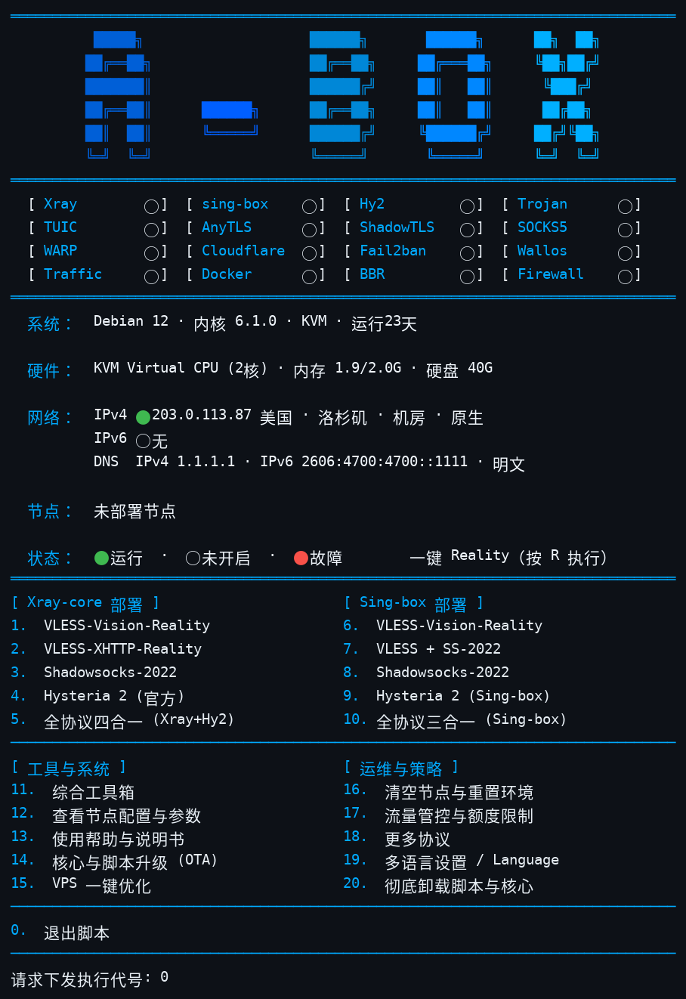
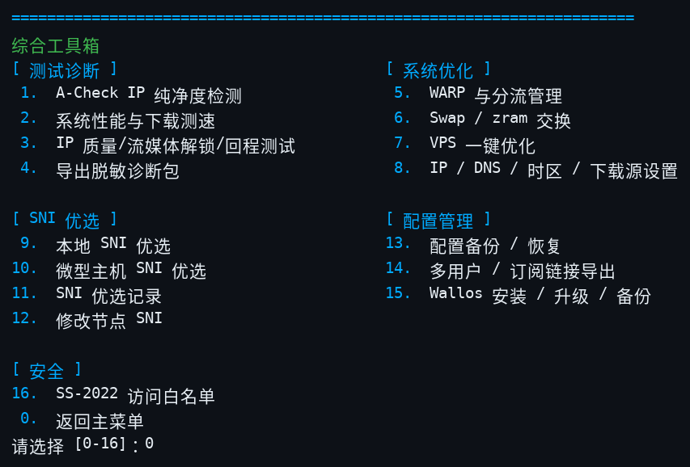
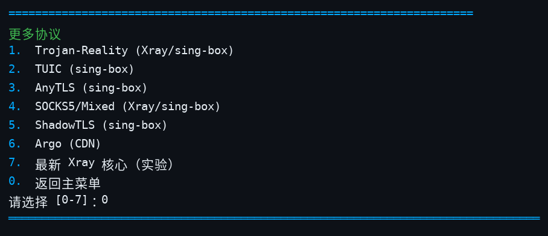

<div align="center">
  
  <p><b>Linux 网络服务一键部署与管理工具箱</b> — 单文件 Bash 脚本 · Xray / sing-box / Hysteria 2 · 六种语言菜单</p>
  <p>
    
    
    
  </p>
  <p>
    <a href="README.md">English</a> ·
    <a href="README-zh.md">简体中文</a> ·
    <a href="README-zh-tw.md">繁體中文</a> ·
    <a href="README-ja.md">日本語</a> ·
    <a href="README-ru.md">Русский</a> ·
    <a href="README-fa.md">فارسی</a>
  </p>
</div>

---

## 界面截图

主菜单（状态矩阵、系统/网络信息与部署菜单）：



综合工具箱（菜单 11）：



更多协议（菜单 18）：



## 这是什么

A-Box 是一个单文件 Bash 脚本（`install.sh`，约 30,000 行），用于在 Linux VPS 上部署和维护代理与网络服务。它负责安装和配置 Xray、sing-box 与官方 Hysteria 2 服务端，生成客户端配置，并把日常运维——防火墙规则、Fail2Ban 防护、DNS 设置、备份、升级与诊断——收进一个六种语言的交互菜单。你在菜单里选定之前，脚本不会部署任何东西；破坏性操作都会先要求确认。

## 快速开始

官方来源，命令已锁定到不可变的提交：

```bash
curl -fsSL https://raw.githubusercontent.com/alariclin/A-Box/a54d166aeed4054921c9f53c9eedb2f3101eecb9/install.sh -o A-Box.sh && sudo bash A-Box.sh
```

第三方镜像（与上面是同一个锁定文件，仅作传输通道，不是官方入口）。不要直接运行：先下载，再与官方来源逐字节比对，通过后才运行。仅在信任该代理时使用镜像；未经核对的镜像文件不得用于生产：

```bash
curl -fsSL https://gh-proxy.com/https://raw.githubusercontent.com/alariclin/A-Box/a54d166aeed4054921c9f53c9eedb2f3101eecb9/install.sh -o A-Box.sh &&
curl -fsSL https://raw.githubusercontent.com/alariclin/A-Box/a54d166aeed4054921c9f53c9eedb2f3101eecb9/install.sh -o A-Box.official.sh &&
cmp A-Box.sh A-Box.official.sh && sudo bash A-Box.sh
```

- 全新的 Alpine 系统请先运行 `apk add --no-cache bash curl sudo`。
- 首次运行后，输入 `sb` 即可再次打开菜单。
- 生产环境使用前，请通过独立可信渠道核对下载到的文件。

## 主菜单

| 编号 | Xray 核心 | 编号 | sing-box |
|---:|---|---:|---|
| 1 | VLESS-Vision-Reality | 6 | VLESS-Vision-Reality |
| 2 | VLESS-XHTTP-Reality | 7 | VLESS + SS-2022 |
| 3 | Shadowsocks-2022 | 8 | Shadowsocks-2022 |
| 4 | Hysteria 2（官方服务端） | 9 | Hysteria 2（Sing-box） |
| 5 | 全协议四合一（Xray+Hy2） | 10 | 全协议三合一（Sing-box） |

Xray 四合一包含 Vision（TCP 443）、XHTTP（TCP 8443）、Shadowsocks-2022（TCP/UDP 2053）与 Hysteria 2（UDP 443）。sing-box 三合一包含 Vision、Shadowsocks-2022 与 Hysteria 2，不含 XHTTP。

| 编号 | 工具与系统 | 编号 | 运维与策略 |
|---:|---|---:|---|
| 11 | 综合工具箱 | 16 | 清空节点与重置环境（删单个/清空全部/重置环境） |
| 12 | 查看节点配置与参数 | 17 | 流量管控与额度限制 |
| 13 | 使用帮助与说明书 | 18 | 更多协议（子菜单见下） |
| 14 | 核心与脚本升级（OTA） | 19 | 多语言设置 |
| 15 | VPS 一键优化 | 20 | 彻底卸载脚本与核心 |
| 0 | 退出脚本 | R | 一键 Reality（快捷键） |

### 更多协议（菜单 18）

独立部署，与上面的组合部署互不影响。每个协议都会询问端口、生成或接受密码、写入前先用核心校验配置、把分享链接登记到菜单 12，并在结束时刷新 Fail2Ban 规则。涉及 SNI 的协议在部署时可选：回车自动优选，或手填域名；已部署节点的 SNI 可在工具箱 12 修改。

| 编号 | 协议 | 说明 |
|---:|---|---|
| 1 | Trojan-Reality | 独立 Trojan + REALITY，可选 Xray 或 sing-box 核心 |
| 2 | TUIC | sing-box 的 TUIC v5，UDP，自签证书 |
| 3 | AnyTLS | sing-box 的 AnyTLS，带 REALITY |
| 4 | SOCKS5 / Mixed | 独立 SOCKS5，带账号密码认证，可选核心 |
| 5 | ShadowTLS | sing-box 的 ShadowTLS v3，转接到内部 Shadowsocks-2022 入站 |
| 6 | Argo (CDN) | VMess / VLESS 经 WebSocket 走 Cloudflare 隧道，服务器不开任何入站端口。临时隧道是随机 `*.trycloudflare.com` 地址，重启即变；固定隧道用你自己的域名和隧道令牌 |
| 7 | 最新 Xray | 实验功能：安装上游最新版 Xray 核心（接管槽位，或以 xray-latest 实例并存并提示端口冲突），可逐个部署 VLESS-Vision / XHTTP / Trojan-Reality / SS-2022 / SOCKS5，也有一键三合一与一键四合一（+ 官方 Hy2），并提供整机端口冲突提醒。失败会告知原因并删除本次部署，绝不自动装回稳定版核心。 |

## 状态面板

菜单顶部是 16 格状态矩阵（运行 / 未开启 / 故障）：Xray、sing-box、Hy2、Trojan、TUIC、AnyTLS、ShadowTLS、SOCKS5、WARP、Cloudflare、Fail2ban、Wallos、Traffic、Docker、BBR、Firewall，其后是系统、硬件与网络信息行。网络行会标注出口 IP 的位置与类型（机房 / 住宅 / 蜂窝、任播或原生）。已部署节点会列出端口与 SNI。绿格只表示服务在运行或端口在监听，不等于端到端连通，请以客户端实测为准。其下是用户区：按节点列出在用用户各自的用量（只用 M/G 单位）、已设的限额与到期；封锁或停用的用户不在面板显示，只在工具箱 14 里管理。

## 综合工具箱（菜单 11）

| 编号 | 功能 | 编号 | 功能 |
|---:|---|---:|---|
| 1 | A-Check IP 纯净度检测 | 9 | 本地 SNI 优选 |
| 2 | 系统性能与下载测速 | 10 | 微型主机 SNI 优选 |
| 3 | IP 质量 / 流媒体解锁 / 回程测试 | 11 | SNI 优选记录 |
| 4 | 导出脱敏诊断包 | 12 | 修改节点 SNI |
| 5 | WARP 与分流管理 | 13 | 配置备份 / 恢复 |
| 6 | 交换内存（zram / Swap）| 14 | 多用户 / 订阅链接导出 |
| 7 | VPS 一键优化 | 15 | Wallos 安装 / 升级 / 备份 |
| 8 | IP / DNS / 时区 / 下载源设置 | 16 | SS-2022 访问白名单 |
| 0 | 返回主菜单 | | |

第 2、3 项的测试脚本默认拉取上游最新版并做结构校验；拉取或校验失败时，回退到经校验的 `test-tools-mirror` 发布中的钉版备份（Ed25519 签名与 SHA-256 双重校验）；两者都不可用时不执行任何脚本。第 1 项 A-Check 同样实时拉取最新版，失败时依次回退签名镜像钉版与本机已验证缓存。

第 1 项 **A-Check** 是配套项目 [A-Check](https://github.com/alariclin/A-Check) 的 IP 纯净度检测工具。脚本从 A-Check 仓库实时拉取最新版，运行前做结构校验（shebang、VERSION 标记、大小、py_compile），并缓存在 `/etc/ddr/tools`；实时拉取失败时，依次回退到签名校验的镜像钉版与本机已验证缓存。需要 Python 3.8 或更高版本。

**多用户管理（工具箱 14)。** 每个已部署的节点——组合与独立协议均可，覆盖 Xray、sing-box、Latest Xray 实例与 Hy2 官方版——都能添加多个命名用户，每人独立凭据、独立分享链接与二维码。可按用户设置每月流量限额 (GB)、到期天数与可用时段；后台每 5 分钟检查一次并自动执行：到期、超限额或时段外的用户会被自动吊销（Xray 家族为热吊销、无需重启）。按用户流量统计与限额执行仅 Xray 家族可用 (StatsService)；sing-box 官方二进制无按用户统计，该核心上仅到期与时段规则生效。全部用户链接可一键导出为订阅文件。

**同协议多实例。** 某独立协议在某核心上已存在时，其部署入口会提供「新增一个实例」：新实例有独立的端口、凭据与用户名单（标签后缀 -2、-3……），可独立管理与删除。

## 子系统

**客户端配置。** 每次部署都会打印分享链接和二维码。菜单 12 随时可重看全部节点参数与链接——包括菜单 18 的独立协议——并导出 Clash / Mihomo YAML、sing-box JSON 与 v2rayN / v2rayNG 配置。支持在服务端添加或吊销多个 UUID，并按用户分别导出。分享链接与导出文件中的节点名只用协议名（Vision、XHTTP、SS、Hy2、Trojan-Reality 等），不带品牌前缀。

**WARP 与分流。** 一键把 Cloudflare WARP 作为原生 WireGuard 出站部署，带流媒体、CN 直连与全局三种预设，外加自定义域名分流规则和多主机 SOCKS5 出站。

**DNS 设置。** 自动实测优选会用真实查询分别测出最快的明文 DNS、DoT 与 DoH；另有自定义填写、Cloudflare / Quad9 预置、改动前的配置快照回滚，以及三模式设置（仅 IPv4 / 仅 IPv6 / 双栈）。DoT 经 systemd-resolved 生效；DoH 经本地 dnscrypt-proxy 转发。

**Wallos。** 可选的自托管订阅管理器（Docker）。安装时选择访问方式：公网 HTTPS（Caddy 终结 Let's Encrypt 的 IP 证书，自动续期；失败时经你确认才回退到下一种方式）、仅本机 + SSH 隧道、用自己域名的 Cloudflare 隧道，或公网明文 HTTP 容灾。带状态页、数据库健康检查与 tar 备份。

**主动防御。** 系统没有 Fail2Ban 时自动安装。它的 jail 除 SSH 外，还覆盖从现行 Xray / sing-box 配置里收割到的全部公网端口——不只是最近一次部署的端口——封禁时长递增。Wallos 有盯住其登录入口的专属 jail。

**快速模式。** 设置 `ABOX_FAST=1` 后，部署过程中的重复确认提示会被跳过。

**备份、升级与 OTA。** 配置备份/恢复使用带版本号的清单格式与恢复密钥（`--export-backup-key`）。核心升级保留现有节点参数；脚本自身的 OTA 更新会显示 SHA-256 并要求明确确认。Xray Geo 数据可单独更新。

**核心版本。** Xray 锁定在 `v26.7.28`：Xray ≥ v26.9.8 要求 X25519MLKEM768 密钥交换，sing-box 客户端目前无法完成该握手。sing-box 与 Hysteria 默认自动跟随官方最新稳定版（7 天冷却、验证通过后才采用），兼容钉版 `v1.14.3` / `app/v2.13.0` 仅作兜底；Argo 用的 cloudflared 锁定 `2026.10.2`，Wallos 的 HTTPS 前端 Caddy 锁定 `2.11.7`，均带 SHA-256 校验。核心二进制按发布清单做 SHA-256 校验，已发布签名的强制 Ed25519 验签（见 `docs/SIGNING.md`）。固定版本与各版本最新稳定版都保存在 `core-binaries` 发布中以便回滚。

**SNI 候选。** 仓库自带 4,158 条候选域名种子列表（`data/sni-candidates.txt`）。工具箱可在目标 VPS 上实测优选（完整版或微型版）并保存记录。列表里的域名只是候选，不保证在你的网络可用、也不保证适合某个具体的 REALITY 部署。拿不到有效列表时该流程直接失败，不硬凑。

## 命令行

| 命令 | 用途 |
|---|---|
| `sudo bash A-Box.sh` | 打开交互菜单 |
| `sudo bash A-Box.sh --help` | 显示命令行帮助 |
| `sudo bash A-Box.sh --lang zh` / `zh-tw` / `en` / `ja` / `ru` / `fa` | 指定界面语言启动 |
| `sudo bash A-Box.sh --self-test` | 运行内置自检 |
| `sudo bash A-Box.sh --status` | 显示受管服务与配置状态 |
| `sudo bash A-Box.sh --start` / `--stop` | 启动或停止受管服务 |
| `sudo bash A-Box.sh --version` | 显示脚本构建标识 |
| `sudo bash A-Box.sh --export-backup-key /secure/path.key` | 导出备份恢复密钥 |
| `sudo bash A-Box.sh --convert-legacy-backup OLD.tar.gz [目录]` | 把旧格式备份转换为现行格式 |

自检通过不等于真实安装或客户端连通验证都通过。

## 系统要求

已实测系统（14 个）：Debian 10 / 11 / 12 / 13、Ubuntu 20.04 / 22.04 / 24.04、Rocky Linux 8 / 9、AlmaLinux 8 / 9、Fedora 40、Alpine 3.18 / 3.19。

| 项目 | 要求 |
|---|---|
| 初始化系统 | systemd 或 OpenRC |
| CPU | amd64 / x86_64 或 arm64 / aarch64 |
| 权限 | root，或 sudo |
| 网络 | 能访问系统软件源与 GitHub / 上游发布端点；部署的端口必须可达（云厂商防火墙也要放行） |

## 注意事项

- 面板的 IP 类型与位置数据来自公开 IP 情报服务，偶有误判；多源比对只能减少、不能消除错误。
- Let's Encrypt 的 IP 证书（Wallos HTTPS 模式）有效期很短（约 160 小时），由 Caddy 自动续期；它们会出现在公开的证书透明度日志中，与所有公开信任的证书一样。
- Argo 临时隧道地址在 cloudflared 每次重启后都会变化；需要固定地址请使用自有域名的固定隧道。
- BBR/FQ 调优、DNS 修改与 WARP 分流都只在你选用时才应用，DNS 与调优改动保留回滚路径。
- 备份与恢复密钥请存放在独立且受保护的位置。

## 合规与免责

请仅在你拥有、管理或已获得明确授权的服务器、网络与系统上使用本项目，并遵守适用于你的法律法规——包括当地关于加密、代理与网络访问的规定。本项目面向授权环境下的系统管理、网络测试与研究。不得用于未授权访问、攻击、滥用或规避合法监管。

本软件按“现状”提供，不附任何担保。运行前请先审阅脚本内容，维护或升级前请保留可恢复的备份。使用后果由你自行承担法律、运维与安全责任。

## 反馈与许可

- 问题反馈：[GitHub Issues](https://github.com/alariclin/A-Box/issues)
- 本项目以 [Apache License 2.0](LICENSE) 发布。
