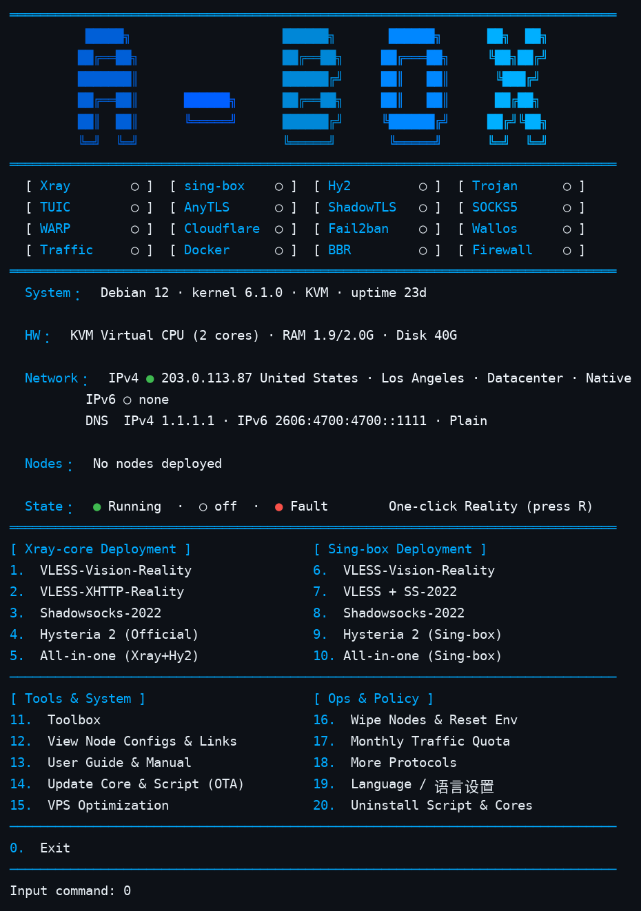
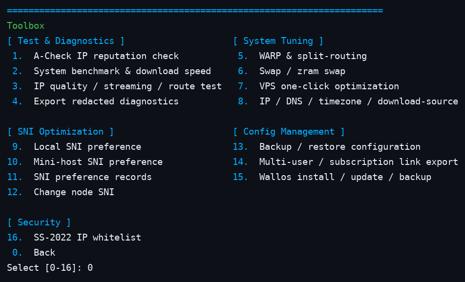
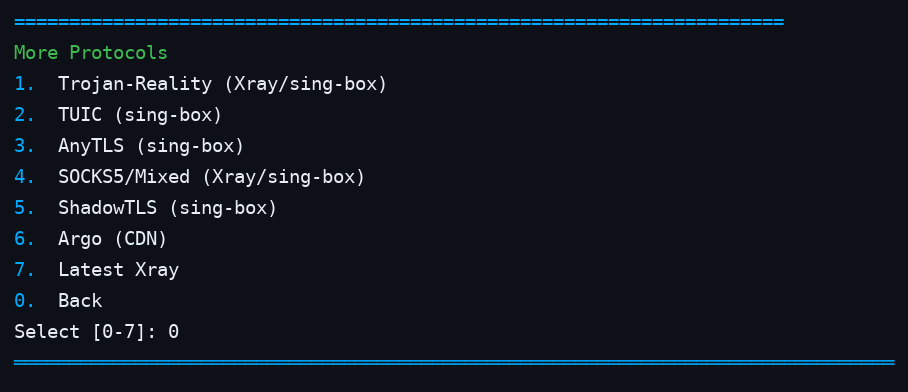

<div align="center">
  
  <p><b>One-click deployment and management toolkit for Linux network services</b> — single Bash script · Xray / sing-box / Hysteria 2 · six-language menu</p>
  <p>
    
    
    
  </p>
  <p>
    <a href="README.md">English</a> ·
    <a href="README-zh.md">简体中文</a> ·
    <a href="README-zh-tw.md">繁體中文</a> ·
    <a href="README-ja.md">日本語</a> ·
    <a href="README-ru.md">Русский</a> ·
    <a href="README-fa.md">فارسی</a>
  </p>
</div>

---

## Screenshot

Main menu (status matrix, system / network information and the deployment menu):



Toolbox (menu 11):



More protocols (menu 18):



## What it is

A-Box is a single-file Bash script (`install.sh`, about 30,000 lines) that deploys and maintains proxy and network services on a Linux VPS. It installs and configures Xray, sing-box and the official Hysteria 2 server, generates client configurations, and provides day-to-day operations — firewall rules, Fail2Ban protection, DNS settings, backups, upgrades and diagnostics — from one interactive menu in six languages. Nothing is deployed before you pick it in the menu, and destructive actions ask for confirmation.

## Quick start

Official source, pinned to an immutable commit:

```bash
curl -fsSL https://raw.githubusercontent.com/alariclin/A-Box/6361ba891393c354492d3da87da5e6aed92e25e1/install.sh -o A-Box.sh && sudo bash A-Box.sh
```

Third-party mirror of the same pinned file (transport only, not an official endpoint). Do not run it directly: download it, verify it byte-for-byte against the official source, then run it. Only use the mirror when you trust the proxy; never run an unverified mirror file in production:

```bash
curl -fsSL https://gh-proxy.com/https://raw.githubusercontent.com/alariclin/A-Box/6361ba891393c354492d3da87da5e6aed92e25e1/install.sh -o A-Box.sh &&
curl -fsSL https://raw.githubusercontent.com/alariclin/A-Box/6361ba891393c354492d3da87da5e6aed92e25e1/install.sh -o A-Box.official.sh &&
cmp A-Box.sh A-Box.official.sh && sudo bash A-Box.sh
```

- On a fresh Alpine system, first run `apk add --no-cache bash curl sudo`.
- After the first run, type `sb` to reopen the menu.
- For production use, verify the downloaded file through an independent trusted channel before running it.

## Main menu

| No. | Xray-core | No. | sing-box |
|---:|---|---:|---|
| 1 | VLESS-Vision-Reality | 6 | VLESS-Vision-Reality |
| 2 | VLESS-XHTTP-Reality | 7 | VLESS + SS-2022 |
| 3 | Shadowsocks-2022 | 8 | Shadowsocks-2022 |
| 4 | Hysteria 2 (official server) | 9 | Hysteria 2 (sing-box) |
| 5 | All-in-one (Xray + Hy2) | 10 | All-in-one (sing-box) |

The Xray all-in-one combines Vision (TCP 443), XHTTP (TCP 8443), Shadowsocks-2022 (TCP/UDP 2053) and Hysteria 2 (UDP 443). The sing-box all-in-one combines Vision, Shadowsocks-2022 and Hysteria 2; it does not include XHTTP.

| No. | Tools & system | No. | Operations |
|---:|---|---:|---|
| 11 | Toolbox | 16 | Wipe nodes & reset environment (delete one / wipe all / reset) |
| 12 | View node configs & links | 17 | Monthly traffic quota |
| 13 | User guide & manual | 18 | More protocols (submenu below) |
| 14 | Update core & script (OTA) | 19 | Language settings |
| 15 | VPS optimization | 20 | Uninstall script & cores |
| 0 | Exit | R | One-click Reality (shortcut key) |

### More protocols (menu 18)

Standalone deployments, independent of the combined bundles above. Each one asks for a port, generates or accepts a password, verifies the configuration with the core before writing it, registers its share link under menu 12, and refreshes the Fail2Ban rules when it finishes. Where a protocol uses an SNI, deployment offers a choice: press Enter for automatic best-SNI selection or type a domain; the SNI of an already deployed node can be changed later in the toolbox (item 12).

| No. | Protocol | Notes |
|---:|---|---|
| 1 | Trojan-Reality | Standalone Trojan with REALITY; choose the Xray or sing-box core |
| 2 | TUIC | TUIC v5 on sing-box, UDP, self-signed certificate |
| 3 | AnyTLS | AnyTLS on sing-box, with REALITY |
| 4 | SOCKS5 / Mixed | Standalone SOCKS5 with authentication; choose the core |
| 5 | ShadowTLS | ShadowTLS v3 on sing-box, detouring to an internal Shadowsocks-2022 inbound |
| 6 | Argo (CDN) | VMess / VLESS over WebSocket through a Cloudflare Tunnel — no inbound port is opened on the server. Temporary quick tunnels get a random `*.trycloudflare.com` address that changes on restart; fixed tunnels use your own domain and tunnel token |
| 7 | Latest Xray | Experimental: installs the newest upstream Xray core (take over the slot, or coexist as a separate xray-latest instance with port-conflict warnings). Deploys VLESS-Vision / XHTTP / Trojan-Reality / SS-2022 / SOCKS5 one by one, plus one-click trio and quad (+ official Hy2) combos and full-machine port-conflict warnings. Failures are reported and the attempt is removed; the stable pinned core is never reinstalled automatically. |

## Status panel

The top of the menu shows a 16-cell status matrix (running / not started / fault) for Xray, sing-box, Hy2, Trojan, TUIC, AnyTLS, ShadowTLS, SOCKS5, WARP, Cloudflare, Fail2Ban, Wallos, Traffic, Docker, BBR and Firewall, followed by system, hardware and network lines. The network line identifies the egress IP's location and type (datacentre / residential / mobile, anycast or native). Deployed nodes are listed with their ports and SNI. A green cell means the service is running or listening; it is not an end-to-end connectivity test — verify with a client. The users section below lists, per node, the active users with their own traffic (shown in M/G units), quota and expiry when set; blocked or disabled users are not shown on the panel — they are managed in the toolbox (item 14).

## Toolbox (menu 11)

| No. | Function | No. | Function |
|---:|---|---:|---|
| 1 | A-Check IP reputation check | 9 | Local SNI selection test |
| 2 | System benchmark & download speed test | 10 | Mini-host SNI selection test |
| 3 | IP quality / streaming / route test | 11 | SNI test records |
| 4 | Export redacted diagnostics | 12 | Edit node SNI |
| 5 | WARP & split routing | 13 | Configuration backup / restore |
| 6 | Swap memory (zram / swap file) | 14 | Multi-user / subscription export |
| 7 | VPS one-click optimization | 15 | Wallos install / upgrade / backup |
| 8 | IP / DNS / timezone / source settings | 16 | SS-2022 access allowlist |
| 0 | Back to main menu | | |

The test scripts (items 2–3) run the latest upstream version by default after a structural sanity check. If the upstream fetch or check fails, they fall back to the pinned copies in the verified `test-tools-mirror` release (Ed25519 signature + SHA-256 verified); if both are unavailable, nothing is executed. A-Check (item 1) likewise fetches the latest version live and falls back first to the signed mirror pin, then to the last verified local cache.

Item 1, **A-Check**, is the IP-reputation checker from the companion [A-Check](https://github.com/alariclin/A-Check) project. The script fetches the latest version live from the A-Check repository, validates its structure (shebang, VERSION marker, size, py_compile) before running it, and caches it under `/etc/ddr/tools`; if the live fetch fails, it falls back to the signature-verified pinned mirror copy, then to the last verified local cache. It requires Python 3.8 or newer.

**Multi-user management (toolbox item 14).** Every deployed node — combos and standalone protocols alike, on Xray, sing-box, the Latest Xray instance and the official Hysteria 2 — can carry multiple named users, each with an own credential and share link / QR code. Per user you can set a monthly traffic quota (GB), an expiry (in days) and an allowed time window. A background check runs every 5 minutes and enforces them: expired, over-quota or out-of-window users are revoked automatically (on Xray cores the revocation is hot, with no restart). Per-user traffic statistics and quota enforcement exist on the Xray family (StatsService); the official sing-box binary exposes no per-user statistics, so on sing-box only expiry and time-window rules apply. All user links can be exported at once as subscription files.

**Multiple instances of one protocol.** When a standalone protocol already exists on a core, its deploy entry now offers "add another instance": the extra copy gets its own port, credentials and user list (tags suffixed -2, -3, ...) and is managed and deleted independently.

## Subsystems

**Client configurations.** Every deployment prints a share link and a QR code. Menu 12 re-displays all node parameters and links at any time — including the standalone protocols of menu 18 — and exports Clash / Mihomo YAML, sing-box JSON and v2rayN / v2rayNG configurations. Multiple UUIDs can be added or revoked server-side, with per-user export. Node names in share links and exported files are the protocol name only (Vision, XHTTP, SS, Hy2, Trojan-Reality, …) — no brand prefix.

**WARP & split routing.** One-click Cloudflare WARP egress as a native WireGuard outbound/endpoint, with streaming, CN-direct and global presets, plus custom domain routing rules and multi-host SOCKS5 outbounds.

**DNS settings.** Automatic measurement picks the fastest resolver from live queries for plain DNS, DoT and DoH; there are also custom entries, Cloudflare / Quad9 presets, a rollback snapshot of the previous configuration, and a three-mode stack setting (IPv4 only / IPv6 only / dual stack). DoT applies through systemd-resolved; DoH runs through a local dnscrypt-proxy forwarder.

**Wallos.** Optional self-hosted subscription tracker (Docker). At install time you choose how it is reached: public HTTPS with a Let's Encrypt IP certificate terminated by Caddy (auto-renewed; falls back to the next option on failure only with your confirmation), local-only access through an SSH tunnel, a Cloudflare Tunnel with your own domain, or plain public HTTP as a fallback. Includes status, database health checks and tar backups.

**Active defense.** Fail2Ban is installed automatically when missing. Its jails cover SSH plus every public port found in the live Xray / sing-box configurations — not just the ports of the last deployment — with incremental ban times. Wallos gets its own jail on its login endpoint.

**Fast mode.** Setting `ABOX_FAST=1` skips repeated confirmation prompts during deployments.

**Backup, upgrades, OTA.** Configuration backup/restore uses a versioned manifest with a recovery key (`--export-backup-key`). Core upgrades keep existing node parameters; the script's own OTA update shows the SHA-256 and asks for explicit confirmation. Xray Geo data can be updated separately.

**Core versions.** Xray is pinned to `v26.7.28`: Xray ≥ v26.9.8 requires an X25519MLKEM768 key exchange that sing-box clients cannot yet complete. sing-box and Hysteria default to the latest official stable release (7-day cooldown, verified before adoption), with the compatibility pins `v1.14.3` / `app/v2.13.0` kept as fallback; Argo uses cloudflared `2026.10.2` and the Wallos HTTPS frontend uses Caddy `2.11.7`, both pinned with SHA-256 verification. Core binaries are checked against the release SHA-256 manifests, and Ed25519 signature verification is enforced where signatures are published (see `docs/SIGNING.md`). Fixed pins and versioned latest-stable builds are kept in the `core-binaries` release for rollback.

**SNI candidates.** The repository ships a seed list of 4,158 candidate hostnames (`data/sni-candidates.txt`). The toolbox can test them from the target VPS (full or mini test) and records the results. A listed hostname is only a candidate: it is not a guarantee that it works from your network or suits a specific REALITY deployment. The workflow fails closed when no valid list is available.

## Command line

| Command | Purpose |
|---|---|
| `sudo bash A-Box.sh` | Open the interactive menu |
| `sudo bash A-Box.sh --help` | Show command-line help |
| `sudo bash A-Box.sh --lang zh` / `zh-tw` / `en` / `ja` / `ru` / `fa` | Start with a given UI language |
| `sudo bash A-Box.sh --self-test` | Run the built-in self-tests |
| `sudo bash A-Box.sh --status` | Show managed services and configuration status |
| `sudo bash A-Box.sh --start` / `--stop` | Start or stop the managed services |
| `sudo bash A-Box.sh --version` | Show the script build identifier |
| `sudo bash A-Box.sh --export-backup-key /secure/path.key` | Export the backup recovery key |
| `sudo bash A-Box.sh --convert-legacy-backup OLD.tar.gz [DIR]` | Convert a legacy backup to the current format |

A passing self-test does not replace a real installation or a client connectivity test.

## System requirements

Tested systems (14): Debian 10 / 11 / 12 / 13, Ubuntu 20.04 / 22.04 / 24.04, Rocky Linux 8 / 9, AlmaLinux 8 / 9, Fedora 40, Alpine 3.18 / 3.19.

| Item | Requirement |
|---|---|
| Init system | systemd or OpenRC |
| CPU | amd64 / x86_64 or arm64 / aarch64 |
| Privileges | root, or sudo |
| Network | Access to the OS package repositories and to GitHub / upstream release endpoints; the ports you deploy must be reachable (open them in your cloud provider's firewall as well) |

## Notes

- The panel's IP-type and location data comes from public IP-intelligence services and can occasionally be wrong; the multi-source check reduces, but does not eliminate, errors.
- Let's Encrypt IP certificates (Wallos HTTPS mode) are short-lived (about 160 hours) and are renewed automatically by Caddy; they appear in public Certificate Transparency logs, as all publicly trusted certificates do.
- Temporary Argo tunnel addresses change every time cloudflared restarts. Use a fixed tunnel with your own domain for a stable address.
- BBR/FQ tuning, DNS changes and WARP routing are applied only when you select them, and DNS / tuning changes keep a rollback path.
- Keep backups and the recovery key in a separate, protected location.

## Compliance and disclaimer

Use this project only on servers, networks and systems that you own, manage, or have explicit permission to operate, and only in compliance with the laws and regulations that apply to you — including local rules on encryption, proxying and network access. It is intended for systems administration, network testing and research in authorised environments. Do not use it for unauthorised access, attacks, abuse, or evading lawful oversight.

The software is provided "as is", without warranty of any kind. Review the script before running it, and keep recoverable backups before maintenance or upgrades. You are responsible for the legal, operational and security consequences of using it.

## Feedback and license

- Issues: [GitHub Issues](https://github.com/alariclin/A-Box/issues)
- Released under the [Apache License 2.0](LICENSE).
